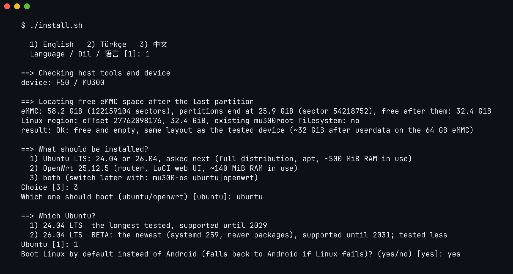
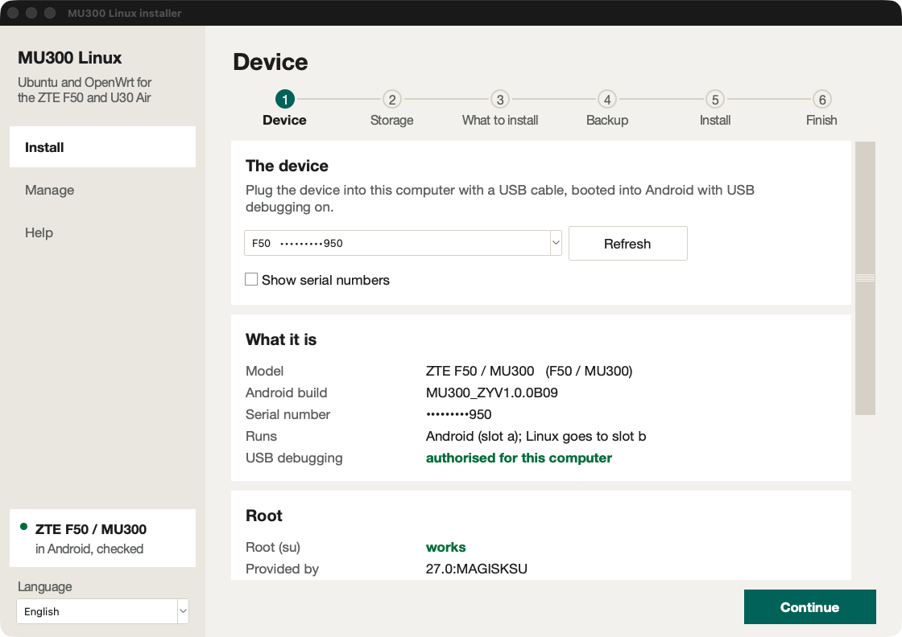
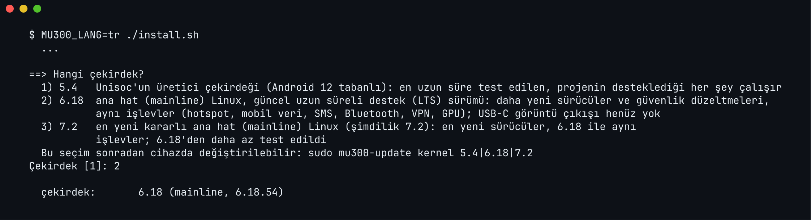
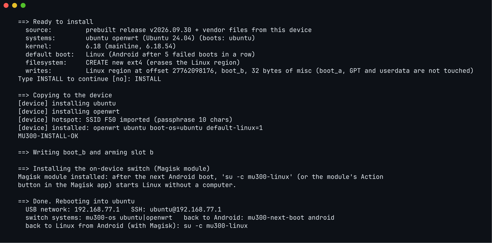

# Linux on the ZTE F50 / MU300 and U30 Air

[](https://github.com/dikeckaan/mu300-linux/releases/latest)
[](https://github.com/dikeckaan/mu300-linux/releases)
[](https://github.com/dikeckaan/mu300-linux/stargazers)
[](https://github.com/dikeckaan/mu300-linux/network/members)
[](https://github.com/dikeckaan/mu300-linux/issues)
[](LICENSE)
[](https://t.me/mu300project)

New here? The [website](https://kaandikec.com/mu300-linux/) explains it step by step, with pictures (English, Türkçe, 中文), and the [wiki](https://github.com/dikeckaan/mu300-linux/wiki) has a glossary and deeper pages.

News and new releases are announced on the Telegram channel: **[t.me/mu300project](https://t.me/mu300project)**. Follow it to hear
about updates first.

The ZTE F50 is a pocket 5G router. This project turns it into a small Linux computer: **Ubuntu** (24.04 or
26.04 LTS) or **OpenWrt** (plain, or with a control panel for the modem), with SSH, Wi-Fi, Bluetooth and its 5G
modem working. Android stays on the device, and you can go back to it at any time.

Think of it as a Raspberry Pi that already has a 5G modem, a Wi-Fi access point and 32 GB of storage inside.

The **ZTE U30 Air** is supported too: the same board and chip with a battery. The installer recognises which one it
is talking to; see [Supported devices](#supported-devices).

> **Türkçe:** ZTE F50 / MU300'ü küçük bir Linux bilgisayarına çevirir: Ubuntu (24.04 veya 26.04) veya OpenWrt
> (düz ya da modem kontrol paneliyle); SSH, Wi-Fi, Bluetooth ve 5G modem çalışır. Android cihazda kalır,
> istediğiniz an geri dönersiniz. Kurulum: önce `./install.sh --check` ile cihazınıza bakın, sonra `./install.sh`
> ile kurun; `./uninstall.sh` ile kaldırın. Linux dahili belleğe ya da SD karta kurulur; bilgisayarsız kurulum için
> Magisk zip'leri de var. ZTE U30 Air de desteklenir (aynı kart, pilli); kurulum programı cihazı kendisi tanır.

---

## A hobby project, at your own risk

This is an experimental hobby project, made in spare time by people who like these devices. It is not a product,
it has no support line, and it comes with **no warranty of any kind**. Everything here is offered as it is; a release
that works on our boards may not work on yours.

What you do with your device is your decision and your responsibility. In particular:

* **Rooting, unlocking, patching and recovery are not part of this project.** Getting a device rooted, flashing with Magisk,
  SPD/BROM or any other third-party tool, and anything you download from anywhere else to do so, is done at your own
  risk, following those tools' own instructions. We did not write them, we do not check them, and we cannot say
  what they do to your device, your data or your warranty.
* **Writing to a phone-class device can leave it unusable.** The installer takes care to touch as little as it can
  (see [Before you start](#before-you-start)), and the device falls back to Android when Linux does not start, but a
  wrong partition, a power cut at the wrong moment, a bad cable or a mistake on our side can still brick it or erase
  it. Keep a backup; do not install on a device you cannot afford to lose.
* **The modem, the radio and the network are yours to use lawfully.** Changing what your device sends (TTL, IMEI-related
  settings, band locks, VPNs) may break your operator's terms or local law. Check before you turn something on.
* **Nothing here is endorsed by ZTE, Unisoc or any operator**, and no trademark is claimed.

To the fullest extent allowed by law, the authors and contributors are not liable for any damage, loss of data,
loss of service, cost or injury arising from the use of this software, this documentation or anything linked from
them. If that is not acceptable to you, do not install it.

> **Türkçe:** Bu deneysel bir hobi projesidir; ürün değildir, desteği ve hiçbir garantisi yoktur. Cihazın root'lanması,
> kilidinin açılması ve Magisk, SPD/BROM gibi üçüncü taraf araçlarla yapılan her türlü işlem bu projenin dışındadır ve
> tamamen sizin sorumluluğunuzdadır. Kurulum cihazı kullanılamaz hâle getirebilir ya da verilerinizi silebilir; yedek
> alın, kaybetmeyi göze alamayacağınız bir cihaza kurmayın. Yazarlar ve katkıda bulunanlar, bu yazılımın kullanımından
> doğabilecek hiçbir zarar, veri veya hizmet kaybından sorumlu değildir.

---

## Supported devices

| | ZTE F50 / MU300 | ZTE U30 Air |
|---|---|---|
| Board, chip | `ums9620_2h10_feimao`, Unisoc T760 (UMS9620) | the same |
| Power | USB only | battery (4050 mAh), charger and fuel gauge |
| LEDs used by Linux | as in ZTE's firmware: network (blue: 4G, white: 5G, red: no service), Wi-Fi (on while the hotspot is up) | as in ZTE's firmware: battery (white from 60 %, blue from 10 %, red below; breathing while it charges; no timeout on the charger), network (the SIM in use - white: the nano-SIM, blue: the eSIM, blinking: switching to it; red: no service), Wi-Fi (white: 5 GHz, blue: 2.4 GHz) |
| Heat alarm | the network LED flashes red, white, blue in turn: the SoC at 85 °C, until it cools down (`thermal-guard`) | the battery LED flashes red, white, blue in turn: the SoC at 85 °C or the battery at 50 °C, until they cool down (`thermal-guard`) |
| USB network | `192.168.77.1` | `192.168.78.1` (so both can be plugged into one computer) |
| Tested | everything below | 5.4, 6.18 and 7.2: USB, Wi-Fi hotspot, Bluetooth, mobile data, VPN, LEDs |
| Battery | - | level, voltage, current, temperature and charging state in `mu300-toolkit`, the `openwrt-luci` dashboard and `/sys/class/power_supply` on every kernel (mainline: `sc27xx-fgu`). Charging: on 5.4 by the vendor charger stack; on 6.18, 7.2 and 7.3 by the `bq256xx` driver (from v2026.10.12; the mainline kernels of v2026.10.11 and older leave charging off). From v2026.10.20: a **charge limit** of 0-100 % (`sudo mu300-power charge-limit 80`, `CHARGE_TO` in the power settings, System > Power on the panel; charging stops at the limit and resumes 5 points below it, and the battery is never held under 5 %), and on the mainline kernels the **Type-C current** the port advertises is read, so a 1.5 A or 3 A port charges at up to 2 A instead of 500 mA |
| USB host (OTG) | - (its USB port is its power supply) | `sudo mu300-usb host` with an OTG adapter: flash drives (FAT, exFAT), keyboards and mice, USB modems and Ethernet adapters, with 5 V from the battery; `sudo mu300-usb device` back to the computer (the default at every boot). Mainline kernels; HDMI through USB-C adapters does not work. **Experimental:** `sudo mu300-usb pd on` lets USB-C power delivery choose the roles (an OTG adapter: host by itself; a PD dock with its charger: charging, and `mu300-usb host` asks it for the host role); off by default (FINDINGS 150) |
| SD card | the Linux filesystem can live on a card instead of the internal storage (see [Install](#install)) | no card slot |
| Buttons | power: held 3 s shuts down | power: a short press wakes the LEDs (they go dark after 60 s), held 3 s shuts down; the Wi-Fi key switches the hotspot 2.4 / 5 GHz, held 3 s turns it off or on |
| NFC | - | a phone held to the device joins the hotspot, as with ZTE's firmware: `sudo mu300-nfc` shows the tag, `wifi` writes the hotspot's name and password (again at every hotspot start), `url https://...` or `text ...` anything else, `clear` empties it, `on`/`off` is the NFC switch of ZTE's web interface (kept in the tag) |

Both run the same kernel, the same systems and the same releases; what differs is a handful of drivers for the U30
Air's charger and LEDs, which its boot image loads in place of the F50's ([`kernel/u30air.fragment`](kernel/u30air.fragment)).
Nothing about the device has to be chosen by hand: the installer reads it from Android, and the boot image, the
LEDs and the default address follow. The U30 **Pro** is a different chip (UMS9632) and is not supported.

### ZTE V50 (MU3351): experimental

The ZTE **V50** (`ro.product.model` V50, `ro.product.device` MU3351, platform `ums9620`; not the Blade V50 phone) is
the F50's platform with two SIM slots, NFC and three front lamps on an AW9523B LED controller. kano (kanoqwq) ported
this project to it in his line of it; what he found and measured is in [FINDINGS 95](docs/FINDINGS.md). **Nobody in
this project has a V50 or has tested one**: install it only if you can get back to Android on your own.

| | ZTE V50 / MU3351 |
|---|---|
| Kernel | mainline only: 6.18, 7.2 or 7.3 of a release that names the V50 (its kernel bundle lists `v50` in `devices`); 5.4 is refused |
| What runs | what runs on an F50: the same systems, modules and settings, USB-powered (no battery) |
| LEDs | NET1 lamp: blue 4G, white 5G, red no service; Wi-Fi lamp: white 5 GHz, blue 2.4 GHz; NET2 dark (`leds-aw9523b`, mainline) |
| USB network | `192.168.79.1` (neither the F50's nor the U30 Air's subnet) |
| SIM cards | one per boot: built-in SIM 1, 2, 3 or the external SIM, as the board has them (`mu300-sim card`, LuCI Cellular > SIM; [docs/SIM-SELECTION.md](docs/SIM-SELECTION.md), FINDINGS 204); untested on a V50 here |
| Not yet | NFC; the eMMC host is kept awake (kano's fix for lost files, patch 0017) |

The installers say so in one line and stop a V50 that is not exactly that (a model V50 with another device or
platform). Linux tells the board by its device tree, as before for the other two: the V50's has the AW9523B, which no
F50's or U30 Air's has, so `mu300-device` says `v50` even where an older installer had labelled it `f50` (after an
update such an installation moves from `192.168.77.1` to `192.168.79.1` unless `/etc/mu300/lan.conf` or OpenWrt's
LAN setting pins the address).

## What you get

* **A real Linux system**, not an app or a container: Ubuntu 24.04 or 26.04 LTS with systemd and `apt`, OpenWrt
  with its LuCI web interface, or OpenWrt with the MU300 control panel (below).
* **Four kernels to choose from:** Unisoc's vendor 5.4, mainline 6.18 LTS, mainline 7.2 (stable) and mainline 7.3,
  the newest (from the next release after v2026.10.19.2 on); 6.18.56 and 7.2.10 in v2026.10.20, with BTF and the eBPF
  hooks that [dae](https://github.com/daeuniverse/dae) needs. KVM (`/dev/kvm`) on all of them.
* **Internet over 5G/LTE**, shared with everything connected to the device.
* **A Wi-Fi hotspot** (5 GHz or 2.4 GHz) and **USB networking**: plug it into a computer and it shows up as a network adapter.
* **SSH access** at `192.168.77.1` (U30 Air: `192.168.78.1`), plus a USB serial console.
* **Bluetooth** and the **Mali GPU** (OpenCL; no screen output).
* **Docker** on Ubuntu, ready to use (`docker run`, `docker compose`); on OpenWrt one `apk add` away, already set up.
* **`mu300-toolkit`**, a menu like `raspi-config`: temperatures, CPU and RAM use, network speeds, performance
  profiles, stress tests, VPN and services.
* **Android stays installed.** One command switches back.

## What you lose (spoiler: nothing)

Android on these boxes has no screen, no speaker and no HDMI either, so Linux takes nothing away that was there. All
it takes is your last excuse for not having a 5G Linux server in your pocket. Installing it costs you nothing; not
trying it costs you the server.

* **Android stays.** Only one of the two runs at a time, and a reboot switches between them (`mu300-next-boot
  android`, or `su -c mu300-linux` from Android).
* **The hardware stays what it is**, under either system:
  * no screen output: HDMI over USB-C does not work (the power-delivery chip never answers), so it is a headless
    machine you use over SSH or the web interface;
  * no speaker or microphone; voice calls are not supported;
  * about 1.4 GB of RAM, because the modem firmware reserves most of the rest. Compressed swap in RAM (zram, half the
    RAM, lz4) is on by default and stretches it; `sudo mu300-zram off` turns it off.

## Before you start

Your device must already be **rooted, and able to boot a modified boot image**: an unlocked bootloader, or a locked
one with a patched TrustOS. You also need `adb` on your computer. Getting to that point is not part of this project:
it does not root, unlock or patch devices and gives no guide for it.

The bootloader does not have to be unlocked. The installers do not refuse a locked one; they say so and ask "Did
you patch TrustOS?". With a patched TrustOS Linux boots on a locked bootloader; without it the bootloader rejects
the Linux boot image and the device goes back to Android by itself after the install.

> **Warning.** Installing writes to the `boot_b` and `misc` partitions (`boot_a` instead of `boot_b` when Android
> runs from slot b, as it often does after an OTA update). If something goes badly wrong you may need a
> recovery tool (SPD/BROM) to revive the device. On the usual 64 GB device Android, its data and the partition table
> are never modified. The **32 GB variant** is the exception: it has no free space at all, and the installer offers to
> make some by shrinking `userdata` — that rewrites the partition table and erases everything in Android, it is
> experimental, and it asks first. Take a full backup with `tools/backup-device.sh` before going that way.
> There is always some risk. Nothing here is endorsed by ZTE or Unisoc.

**What protects you:**
* Linux is installed into empty, unused space on the internal storage, or onto an SD card; Android's partitions are not touched (except on the 32 GB variant, where you can choose to shrink `userdata` to create that space).
* Linux starts as a "trial boot". If it fails to start 5 times in a row (you choose 1-6), the device returns to
  Android by itself.

* `./uninstall.sh` puts everything back.

**You need:**
* A ZTE F50 / MU300 or U30 Air, rooted, connected by USB, with USB debugging enabled.
* A computer with `adb`:
  * **macOS or Linux:** also Python 3, `lz4` and `curl` (usually already installed).
  * **Windows 10/11:** PowerShell. The installer installs Python 3 (for your user, with winget or from
    python.org) and its `lz4` module itself when they are missing. Use `install.ps1` / `uninstall.ps1` below,
    or `install.cmd` / `uninstall.cmd` from cmd.exe (no execution-policy change needed).
* About 15 minutes.

## Install

**Step 0 — back up what cannot be replaced (recommended).**

```sh
tools/backup-device.sh          # macOS / Linux, device in rooted Android
```

This copies your unit's own data — `prodnv`, the modem calibration and IMEI partitions, the bootloader chain — to
your computer and verifies every dump against the device. Installing never touches these, but if they are ever lost
no firmware download can bring them back, and the modem stays broken. Keep the folder somewhere safe and out of any
repository: it contains your IMEI.

**Step 1 — check your device.** This only reads; it writes nothing.

```sh
./install.sh --check          # macOS / Linux
.\install.ps1 -Check          # Windows (PowerShell)
install.cmd -Check            # Windows (cmd)
```

It reports the storage size, where Android's partitions end and how much free space follows them. On the 64 GB
device that is about 32 GiB.

If it reports none at all, you have the **32 GB variant**, where `userdata` fills the disk (a 64 GB unit can look
the same after a vendor firmware flash replaced its partition table, issue #32). The installer can make
room by shrinking it — that erases everything in Android and rewrites the partition table, so it is experimental
and it asks first. Back the device up with `tools/backup-device.sh` before saying yes. If the numbers look like
neither case, stop and open an issue with what `--check` printed; they identify the variant. With an SD card in the
slot there is a way that erases nothing: `--check` says so, and the installer offers the card instead.

**Making room is a reset, and the installation resumes afterwards (EXPERIMENTAL).** Android keeps its data
encrypted (file-based encryption, with the metadata key in `/metadata`), and a data filesystem cleared from outside
is one it cannot mount: it would stop in its recovery, waiting for a person at a screen these devices do not have.
So the installer does what kano's desktop installer does (kanoqwq's branch `clean-tf-7.2`, commits `f6b0668d` and
`0e19fe32`): before anything is written it saves a backup (the partition table, `misc`, `boot` and the boot chain of
both slots - never the NV or calibration partitions) and a *transaction* on this computer, in `~/mu300-backups/<date>-<id>/`
(`MU300_BACKUP_DIR` elsewhere). Then it shrinks `userdata` (the backup copy of the table first, both read back),
writes a token to the first 4 KiB of the new region (outside every partition, where the reset does not reach) and
asks Android's own recovery, through the bootloader message in `misc`, to format `userdata` on the next start.
The device restarts, Android is reset - **all of its data is erased** - and starts as new.

Then: set Android up again, turn USB debugging back on and bring root back (Magisk survives in the boot partition,
but its app and its grants were in the erased data: install the Magisk app again and let Shell have root), and run
`./install.sh` (or `.\install.ps1`, or the window) again. It finds the transaction and continues, when the device
(serial, the eMMC's CID), Android's slot, `userdata`'s node, start and size, the partition table (both copies, every
CRC), the region by the installers' own arithmetic, the token on the device and the installer's own tools (the GPT
reader, the region's arithmetic, what formats and fills it, `boot/init`) are all still the ones it was prepared with;
otherwise it stops, having written nothing, and says which. `--resume` insists on a transaction, `--no-resume`
installs as if nothing had been prepared (the region is then space that holds data, and you type `overwrite`),
`--transaction FILE` takes another one (`-Resume`, `-NoResume`, `-Transaction` for `install.ps1`). While a
transaction waits the installer does not update itself. kano says he ran the stage after the reset's check against
his V50's record ("passing the 8.00 GiB partition, identity, token and payload checks") and that the reset itself
"still needs real MU300 validation"; this project has not run it on a device either (FINDINGS 112).

**On the SD card.** With a card of at least 700 MiB in the slot the installer asks whether the Linux filesystem
goes there instead of into the free eMMC space (`MU300_STORAGE=sd` answers it). The card is formatted (ext4,
label `mu300sd`); on the eMMC only `boot_b` (or `boot_a`) and 32 bytes of `misc` are written, so a device with a small eMMC
needs no repartitioning. A card that holds another Linux (ext4) filesystem is never formatted. A `mu300sd` card
always comes first. Without the card the device starts the internal installation if there is one; with none, it
waits 8 s for the card (30 s while one is still being detected), then returns to Android after about five minutes.
All four kernels have the card's driver (5.4, 6.18 and 7.2 read it on the boards; 7.3 not tried yet). The U30 Air has no card slot, so it never asks there.


* Put the card in while the device is switched off. A card inserted while Linux runs is seen, but it cannot be
  read until the next reboot.
* The boot image starts any card whose filesystem is labelled `mu300sd`. That keeps the device bootable when the
  card is replaced, and it also means that whoever has the device can start a system of their own from a card.

**Step 2 — install.**

```sh
./install.sh                  # macOS / Linux
.\install.ps1                 # Windows (PowerShell)
install.cmd                   # Windows (cmd)
```



It asks a few questions (internal storage or SD card; Ubuntu, OpenWrt or both, and which Ubuntu, which OpenWrt and
which kernel; which one boots; whether Linux boots by default; a password; the VPN module), downloads the ready-made images,
copies the Wi-Fi and modem files from your own device, shows exactly what it is about to write, and waits for you to
type `INSTALL`. Then it reboots into Linux.

**A window instead of a terminal.** Started by hand, the installer first asks whether you want the graphical
installer: the same steps in a window, with the device, its storage and the progress shown rather than printed
(`MU300_GUI=0` never asks, `MU300_GUI=1` starts it without asking). It needs a Python 3.8 or newer with tkinter
(Tk 8.6 or newer); the installer looks for one, says what is missing, and installs nothing without showing the
command and getting a yes. The window drives this same `install.sh` / `install.ps1`, so it installs nothing
differently. It can also be started directly: `python3 gui/mu300-gui.py`.



**A beta, when there is one.** When GitHub has a prerelease newer than the newest release, the installer asks
whether to install that beta instead and names both (default: no). `MU300_RELEASE=<tag>` / `-Release <tag>` picks a
release and asks nothing.

**Without a terminal.** `./install.sh --answers FILE` (`.\install.ps1 -AnswersFile FILE`) takes every answer from
variables and asks nothing; a question without an answer stops the run and names its variable.
`MU300_PROGRESS=1` adds a machine-readable progress stream. See [docs/INSTALLER-AUTOMATION.md](docs/INSTALLER-AUTOMATION.md).

The installer speaks **English, Türkçe and 中文**: it asks at the start (English is the default; `MU300_LANG=tr`
or `.\install.ps1 -Lang zh` skips the question). Adding a language is one file: see `i18n/README.md`. Before anything else it brings your copy of the project up to date
with GitHub - a `git clone` is fast-forwarded, a downloaded zip gets the files that changed - and restarts itself if
there was anything new; without GitHub it simply continues (`MU300_NO_SELF_UPDATE=1` / `-NoSelfUpdate` skips it).

With Ubuntu it asks for the release: **24.04 LTS** (the default, the longest tested) or **26.04 LTS** - the
newest, with systemd 259, on kernel 6.18, 7.2 or 7.3. An installed Ubuntu moves
to the other release with `sudo MU300_UBUNTU=26.04 mu300-update apply` (or `24.04`), keeping settings and data.

It also asks for the **kernel**:

| choice | kernel | |
|---|---|---|
| 1 | 5.4 | Unisoc's vendor kernel (Android 12 base): the longest tested, everything this project supports |
| 2 | 6.18 | mainline Linux, the current long-term (LTS) release: newer drivers and security fixes, the same functions (hotspot, mobile data, SMS, Bluetooth, VPN, GPU); no USB-C video output yet |
| 3 | 7.2 (stable) | the stable 7.2 series of mainline Linux: newer drivers, the same functions as 6.18; tested less than 6.18 |
| 4 | 7.3 | the newest mainline release: the newest drivers, the same functions as 6.18; tested less than 7.2 (from the next release after v2026.10.19.2 on) |

It can be changed later on the device with `sudo mu300-update kernel 5.4`, `... kernel 6.18`, `... kernel 7.2` or
`... kernel 7.3`. Ubuntu 26.04 needs 6.18, 7.2 or 7.3 (its programs use system calls 5.4 does not have), and so does USB host mode on the
U30 Air (tried on 6.18 and 7.2; not yet on 7.3).



Before it writes anything it shows what it is about to do and waits for `INSTALL`:



**The boot chain of the Linux slot.** Linux boots with the bootloader chain of its own slot, but runs Android's modem.
After an Android update (OTA) the two slots hold different firmware builds, and the Linux slot's chain is still the
factory one (issue #86). So the installer copies `uboot`, `sml`, `teecfg`, `trustos` and `vbmeta` of Android's slot to
the Linux slot whenever they differ - and only those five, never the NV or calibration partitions or anything of
Android's slot. The images the Linux slot held are backed up first, to the Linux filesystem (`.mu300/bootchain/`) and
to `work/bootchain/` on the computer; each written image is read back, and a mismatch puts the old ones back and stops
before Linux is armed. The summary says what it will do ("boot chain: identical on both slots" on a device that never
took an update). Experts can skip it: `MU300_SYNC_BOOTCHAIN=0 ./install.sh`, `.\install.ps1 -NoBootchainSync`.
Details: [FINDINGS 40](docs/FINDINGS.md). Thanks to kano for the advice.

If Linux is already installed it asks whether to **update** or **wipe**:

* **update** — reinstalls the systems and keeps everything you added to them or changed in them: your files
  wherever they are, settings, accounts and passwords, services you enabled or disabled. Packages you installed
  yourself are installed again at the first boot (see [Updating](#updating)). From the first release with a four-field tag (vYYYY.MM.DD.N) on; an older release
  keeps only `/etc/mu300`, accounts and home directories, `/usr/local`, SSH host keys and OpenWrt's UCI config.
* **wipe** — erases the Linux filesystem and installs from scratch.

An update then asks **Keep the current password? (yes/no)** for the systems that have a login password of their own
(Ubuntu's `ubuntu`, OpenWrt's `root`). **yes** (the default) asks the current password once per system and checks it
on the device against the installed system's own hash (yescrypt on Ubuntu, SHA-crypt or MD5-crypt on OpenWrt; just
Enter for none, OpenWrt's `root` as it ships); three wrong tries stop the installer before anything is written, and
nothing is changed. **no** asks a new password, typed twice. A system the update installs new still gets the new
password. In answers mode: `MU300_ANS_KEEP_PASSWORD`, `MU300_ANS_CURRENT_PASSWORD` (one try,
[docs/INSTALLER-AUTOMATION.md](docs/INSTALLER-AUTOMATION.md)).

The check runs nothing of the installed Linux system on Android's side: it uses the project's own `mu300-pwcheck`
(static, libxcrypt) and busybox from the release's kernel bundle. Releases up to v2026.10.16.1 have no
`mu300-pwcheck`: with them an Ubuntu password (yescrypt) cannot be checked and the installer stops; answer **no** then
(FINDINGS 126).

If the device is running Linux rather than Android when you start, the installer notices and offers to reboot it
into Android for you over SSH.

**Step 3 — log in.** Wait about a minute, then on the computer it is plugged into:

```sh
ssh ubuntu@192.168.77.1        # the password you chose during the install
```

For OpenWrt use `ssh root@192.168.77.1`, or open `http://192.168.77.1` in a browser for LuCI. On a U30 Air the
address is `192.168.78.1` instead.

The Wi-Fi network the device broadcasts is its hotspot; unless you chose otherwise it uses the name and password
copied from Android. It is **WPA2-PSK (CCMP) only**, on every device: WPA3 (SAE) is disabled on this Wi-Fi chip,
because the U30 Air's firmware WPA3 could let a client in without the password
([docs/U30AIR-SAE.md](docs/U30AIR-SAE.md), FINDINGS 80 and 175). A hotspot that was set to WPA3 is switched to WPA2
with the same password at the first boot of a newer image (or switched off, never left open, if it has no usable
password), and LuCI shows a notice saying so; choosing WPA3 in LuCI leaves that access point down, with a line in
the log.

### OpenWrt with the MU300 control panel

The third system, `openwrt-luci`, is OpenWrt 25.12 with a LuCI application written for these devices, in English,
Turkish and Chinese (29 more with the lang extra, see [Languages](#languages)). It is an option next to plain OpenWrt, not a replacement: the installer asks "Which OpenWrt?"
whenever OpenWrt is chosen (`MU300_OPENWRT=plain|luci` answers without asking), and the system lives in
`/openwrt-luci` on the Linux disk. Its release asset is `mu300-openwrt-luci-rootfs.tar.gz`; switch to it with
`sudo mu300-os openwrt-luci`. The panel's pages:

* **Status dashboard:** live radio readings (signal, bands, cells, temperatures), mobile data state, the Wi-Fi clients
  with their speeds, connected time, name and address, the carrier's DNS servers and the connection count; on the U30 Air
  also the battery: its level, whether it charges, and the power in watts. When the modem is busy the page keeps its
  last readings and says how old they are instead of going blank.
* **Cellular > Network locks:** network mode, band, cell and EN-DC locks that persist across reboots and are replayed at boot, before
  the radio comes on where the modem allows it.
* **Cellular > SMS:** read, send and delete messages. A pool daemon syncs the SIM every 30 s with `AT+CMGL`, which marks
  unread messages on the SIM as read (measured, FINDINGS 35; the panel keeps its own unread state). Do not run
  `sms delete read` on this system. A message leaves the SIM only once the pool's copy is on the disk (an fsync of
  that file and its directory, never a global sync). A long message whose other parts never come is shown after an
  hour with what did arrive, marked incomplete.
* **Cellular > SMS forwarding:** off until turned on. Received messages go on to a webhook (JSON, form or plain text,
  extra headers; the standard fields or a body of your own with `{sender}`, `{time}`, `{text}`, `{device}`,
  `{message}`, each value escaped for the type), a Telegram chat, an e-mail address (only when the image has `msmtp`) and/or another phone by SMS, through a
  template (`{sender}`, `{time}`, `{text}`, `{device}`), with sender allow/deny lists and keywords. Failed deliveries
  are retried (30 s, doubling, an hour at most, ten times); a delivery log (with a "Clear" button) and a "Send test"
  button. For services that answer HTTP 200 with their own error inside, the webhook can check the answer
  (`errcode=0`, `code=0`, `ok=true`): the device keeps only the result, never the answer. Tokens, passwords
  and the webhook address and headers stay in `/etc/mu300/sms-forward.conf` (root only) and are never shown again.
* **Cellular > AT terminal:** guarded AT commands over the same channel daemons the system uses. A command that scans,
  changes the radio, the APN, the SIM or a setting that persists into Android is explained and sent only after a
  click; a network scan runs in the background and the page follows it. The Device page keeps a log of the panel's
  recent modem operations (names and timings, never values or messages).
* **VPN** (its own top-level menu, with the [VPN module](#vpn) v2): **Overview** (state, active profile, engine, tunnel
  addresses, uptime, live rates, the exit IP behind a button, Start/Stop/Restart, the kill switch and the IPv6 setting
  behind a confirmation), **Profiles** (add from a share link, pasted text, a file or a URL; test the latency; rename,
  show and edit the config, delete), **Subscriptions** (a URL that yields profiles, refreshed by hand or on a schedule),
  **Engines** (Xray, sing-box, mihomo, dae: install, update or remove, online or from an uploaded tarball checked
  against the module's release), **Settings** (kill switch, IPv6, LAN ranges that bypass the tunnel, Tailscale, DNS)
  and **Logs**. Without the module every page offers to install it.
* **Cellular > Device management:** USB role (device or host), the USB network mode (NCM, ECM or RNDIS, applied at the next boot) and
  adapters in host mode that can join the LAN bridge.
* **Cellular > Adapter settings:** how the panel reaches the modem (AT backend, serial port, custom AT adapter).
* **System > Languages:** the language of the interface, and the lang extra: download it, or upload the file.
* **System > Power:** the active power profile and why (in the page's language), the battery, the power source and the charger's input current, the idle knobs of the three profiles (Wi-Fi idle minutes, radio idle keep/lte/off, LEDs, CPU), the saver threshold and the charge limit (0-100 %, U30 Air; also `mu300-power charge-limit N`), and what a boot the charger started does (U30 Air: charge only until the Wi-Fi key or a held power key starts it, off when unplugged; or start normally, `POWER_ON_CHARGER=1`). The U30 Air powers off cleanly on an empty battery by the stock rules (docs/FINDINGS.md 196, 197).
* **System > Packages after an update:** the packages you had installed yourself and what the update did with them
  (see [Updating](#updating)): what came back, what is pending or failed and why, the settings set aside, and the
  buttons Try again, Repair DNS (after a confirmation) and Dismiss.
* **System > Terminal:** a root shell in the browser ([ttyd](https://github.com/tsl0922/ttyd)). It listens on the LAN
  address only (port 7681; the cellular side never reaches it), and opens a shell only for a one-time token the page
  gets for a logged-in panel session: there is no second password to guess. It closes after 15 minutes without
  activity (`uci set ttyd.mu300.idle=<seconds>`, 0 never). A panel opened over https opens it in a tab of its own
  (ttyd serves HTTP: its websocket over TLS fails in Chrome). **Terminal settings** is ttyd's own page; turning the
  instance off (`enable`) removes the terminal.

IPv6 on this system is relayed from the carrier (router advertisements and NAT66) instead of the prefix extension
plain OpenWrt uses. Aurora is the default theme, Bootstrap stays installed. Its boot timings, measured on an F50
and a U30 Air, are in [FINDINGS 35](docs/FINDINGS.md).

From v2026.10.20 one stuck AT command no longer takes the whole panel down: every modem read has a deadline, the
pages send their calls one at a time and back off after failures, and the lock reading is served from a cache while
the modem is busy. On OpenWrt an AT command now takes about 0.13 s instead of a full second (the shell's `read` could
not wait for fractions of a second), so the dashboard's readings arrive 7 times faster ([FINDINGS 40](docs/FINDINGS.md)).


The panel is the work of kanoqwq ([`kanoqwq/mu300-linux`](https://github.com/kanoqwq/mu300-linux), branch
`clean-tf-7.2`); this repository ports it, with translations rewritten as standard LuCI catalogs and the shared
fixes applied to all three systems. The theme is [Aurora](https://github.com/eamonxg/luci-theme-aurora) by
eamonxg. The app's own notes are in [`openwrt/luci-app-mu300/README.md`](openwrt/luci-app-mu300/README.md).

### A web panel on Ubuntu (optional)

Ubuntu can have a web panel too: [Cockpit](https://cockpit-project.org/), Ubuntu's own web console (a terminal,
logs, services, networking, storage, accounts), with an **MU300** page in it: the mobile network (operator,
technology, registration, RSRP/RSRQ), mobile data on/off, data usage and live rates, the battery and temperatures,
SMS (read, send, delete), the VPN (on/off, profiles; with the VPN module), the CPU profile and the power state, the
hotspot's name and password, joining a Wi-Fi network, and updates (`mu300-update check` / `apply`). Network locks stay
a feature of the OpenWrt panel. It is the panel extra, not part of the image:

```sh
sudo mu300-extra install panel                      # Cockpit from Ubuntu's archive (about 12 MB, online)
sudo mu300-extra install panel --from mu300-extra-panel-offline.tar.gz   # offline: the release's file, Cockpit inside
sudo mu300-extra remove panel
```

or answer yes to the installer's question (it takes the offline file, so the first boot needs no network). Then open
`https://192.168.77.1:9090` (the U30 Air: `.78.1`; your LAN address if you changed it), accept Cockpit's own
certificate, and log in as `ubuntu` with your password; "Turn on administrative access" (your password again) for
the pages that need root. Cockpit listens on the LAN address only (USB and the hotspot: `ListenStream=LAN-ADDRESS:9090`
with `FreeBind=yes`, so it is up from the start of the boot; it follows a changed LAN address; only the LAN's /24
may connect, `IPAddressAllow`), and the firewall drops everything new from the cellular uplink (and a Wi-Fi uplink) in front of it anyway; root cannot log in,
the login page offers no other host, and a session ends after 15 minutes idle. An update replaces Ubuntu without
Cockpit's packages: its first boot puts them back in the background (from the extra when it carries them, else from
the archive once online). `mu300-panel status` says where it is.

## Everyday use

`sudo mu300-toolkit` opens a menu for everything below. The direct commands:

| I want to… | Command |
|---|---|
| Watch temperatures, CPU, RAM, network speed | `mu300-toolkit top` |
| Make it faster, or cooler and quieter | `sudo mu300-toolkit profile performance` (also `eco`, `balanced`) |
| Test stability under load | `sudo mu300-toolkit stress all 10` |
| Move the CPU voltage a little (EXPERIMENTAL, can damage the device for good) | `sudo mu300-cpu voltage set -6250,-3125,0 --confirm EXPERIMENTAL`; see [CPU voltage offset](#cpu-voltage-offset-experimental) first |
| Check the mobile connection | `sudo mobile-data status` |
| Set the APN | Ubuntu: `/etc/mu300/mobile-data.conf` (`MU300_APN`, `MU300_PDP_TYPE`). OpenWrt: LuCI → Network → Interfaces → wan, or `uci set network.wan.apn='…'; uci commit network; ifup wan`. Leave it empty to keep the context the SIM defines, which is what most carriers expect |
| No mobile data while roaming | `sudo mobile-data roaming off` (`on` allows it again, the default; `sudo mobile-data roaming` shows the setting, the network and whether data is held back). Ubuntu: `MU300_DATA_ROAMING=0` in `/etc/mu300/mobile-data.conf`; OpenWrt: `network.wan.roaming` (`roaming_internal` for the other SIM), the panel's dashboard or LuCI → Network → Interfaces → wan. SMS and calls are not affected. Some SIMs report roaming at home (an MVNO, national roaming): those need it on (FINDINGS 120) |
| Use the F50's internal SIM instead of the card in the slot | `sudo mu300-sim select internal` (`external` goes back; it takes effect at the next boot, the external card is the default, and nothing is written to the modem or the SIM). OpenWrt: LuCI → Network → Interfaces → wan → SIM source, with that card's own APN; Ubuntu: its APN in `/etc/mu300/mobile-data.conf`. F50 only, and the device must have an internal SIM fitted (docs/SIM-SELECTION.md) |
| Change the Wi-Fi name or password | Ubuntu: edit `/etc/mu300/hotspot.conf`, then `sudo systemctl restart mu300-hotspot`. OpenWrt: LuCI → Network → Wireless (that file is only read once, at the first boot) |
| Change the hotspot's channel | Ubuntu: `CHANNEL=` in `/etc/mu300/hotspot.conf` (`auto`, or on 5 GHz 36-48 / 149-165). OpenWrt: LuCI → Network → Wireless. Never a DFS channel (52-144): the Wi-Fi driver cannot detect radar, so hostapd could not start there; a DFS channel is replaced by 36 (149 where 36-48 are not allowed) and the log says why (FINDINGS 42) |
| Read and send SMS | `sudo sms list`, `sudo sms send NUMBER TEXT...`, `sudo sms delete INDEX` (an index, `read` or `all`; anything else is refused before it reaches the modem) (OpenWrt with the panel: Cellular → SMS; Ubuntu with the panel extra: the MU300 page) |
| Send a USSD code (balance, own number) | `sudo mu300-ussd '*101#'` |
| Change the kernel | `sudo mu300-update kernel 6.18` (or `5.4`, `7.2`, `7.3`), then reboot |
| Connect the device to someone else's Wi-Fi | `sudo mu300-toolkit` → Network → Wi-Fi → "Join a network", or `sudo wifi-client scan` then `sudo wifi-client connect "NAME"` (it asks for the password); see [Wi-Fi client](#wi-fi-client) |
| Update to the newest release | `sudo mu300-update check` then `sudo mu300-update apply`. The device looks for a new release at boot and every 6 hours and says so at login and in `mu300-toolkit`; it never installs one by itself |
| Fixed TTL for mobile data (so the operator cannot tell hotspot traffic from the device's own) | `sudo mu300-ttl set 64` (`sudo mu300-ttl off` goes back to the default), `mu300-toolkit` -> Network -> TTL, or LuCI Cellular -> TTL. On the mainline kernels the rule is in tc and flow offloading stays on; on 5.4 it is in nftables and offloading is off while a TTL is set |
| Compressed swap in RAM (zram) | On by default on every system and kernel: half the RAM (~700 MB of swap), lz4, priority 100, `vm.swappiness` 100. `mu300-zram` shows it and what it costs; `sudo mu300-zram off` / `on` (kept across reboots and updates), or `mu300-toolkit` → System → Compressed swap. Size, compressor (`zstd` packs ~3.5:1 against lz4's ~2.5:1, for more CPU) and swappiness: `/etc/mu300/zram.conf`, see `/opt/mu300/lib/zram.conf.example` (FINDINGS 162) |
| Switch between OpenWrt and Ubuntu | `sudo mu300-os openwrt` / `sudo mu300-os ubuntu` (`openwrt-luci` for the one with the control panel) |
| Failed boots in a row before it falls back to Android (1-6, default 5) | `sudo mu300-next-boot attempts N` |
| Keep Linux for good: never back to Android by itself, only by hand | `sudo mu300-next-boot lock` (or "Lock Linux" on the panel's home page); `unlock` goes back to the attempts. See [Locked Linux](#locked-linux) |
| Go back to Android | `sudo mu300-next-boot android`, then `sudo reboot` |
| Return to Linux from Android | `su -c mu300-linux` on the device (see below), or `boot/android-boot-linux.sh work/boot-linux-slotb.img` from a computer |
| Send all traffic through a VPN | see below (`sudo mu300-extra install vpn` first) |
| Add or remove optional parts (the VPN module, more web interface languages) | `mu300-extra list`, `sudo mu300-extra install vpn`, `sudo mu300-extra remove vpn` (`lang` for the languages) |
| Save battery: profiles, radios that go idle when nobody is connected, a charge limit | `mu300-power status`, `sudo mu300-power profile battery` (`plugged`, `saver`, `auto`), `sudo mu300-power set battery.WIFI_IDLE 10`, `mu300-power log 5 /tmp/power.csv`; on `openwrt-luci` the page System -> Power. A boot that started from a charger stays a charging boot (LED blinking, hotspot and modem down) until the Wi-Fi key is pressed; see FINDINGS 36 |
| Language of the web interface (OpenWrt) | System -> System -> Language and Style; more languages: see Languages below |
| Find out which LED is which | `sudo mu300-led test` |
| `adb shell`, `adb push`/`pull`, `adb forward` to Linux from a computer, as with Android | on by default, for every computer (a root shell without a password for anyone with a cable); only your own computers: `sudo mu300-usb adb key adbkey.pub`, then `sudo mu300-usb adb auth keys`; not at all: `sudo mu300-usb adb off`; see [adb to Linux](#adb-to-linux) |

### CPU voltage offset (EXPERIMENTAL)

> **EXPERIMENTAL: this can PERMANENTLY DAMAGE your device. You use it entirely at your own risk.** Changing the CPU
> voltage can make the device unstable, corrupt your data or break the hardware for good, and nobody can repair or
> replace a device damaged this way. It is off by default; if you are not sure, leave it off.

On the mainline kernels (6.18, 7.2, 7.3; not 5.4; on 7.3 not yet tried on a device) the CPU voltage can be moved per core cluster, domains 0, 1, 2 = CPUs
0-3, 4-6, 7: from -25 mV to +12.5 mV in steps of 3.125 mV. The SoC firmware applies it once per boot, so a new value
takes effect at the next reboot, as **one trial boot**: it is kept once that boot has been up 10 minutes, and it is
dropped (back to 0, the setting cleared) by any boot with it that ends in a crash, a watchdog reset or a power cut,
and by a trial boot that ends before its 10 minutes. It is refused on SoC firmware whose encoding is not known (only
the F50's SML build is known; the U30 Air's not yet), and a raise needs the CPU regulator's maximum from the device
tree.

```sh
sudo mu300-cpu voltage status                                     # what runs, what is asked for, the voltage table
sudo mu300-cpu voltage set -6250,-3125,0 --confirm EXPERIMENTAL   # uV for domains 0, 1, 2
sudo mu300-cpu voltage stress 10                                  # test it under load during the trial boot
sudo mu300-cpu voltage off                                        # back to the stock voltages at the next boot
```

The same with the same warning, each asking you to type `EXPERIMENTAL`: OpenWrt's control panel (System > CPU), the
Ubuntu panel's Power page and `sudo mu300-toolkit` (Performance). If Linux no longer comes up, the device falls back
to Android after the failed boots in a row (`mu300-next-boot attempts`, above); deleting `.mu300/cpu-voltage` on
the Linux disk turns the offset off. The firmware encoding is kano's work ([kanoqwq](https://github.com/kanoqwq));
how it is applied and why these limits: [docs/FINDINGS.md](docs/FINDINGS.md) section 133, and the wiki page
[CPU Voltage Offset](https://github.com/dikeckaan/mu300-linux/wiki/CPU-Voltage-Offset).

### adb to Linux

Linux offers adb over the USB cable, next to the USB network and the serial console, as Android does: `adb shell`
(a root login shell), `adb push`/`pull`, `adb forward`/`reverse`. From the release after v2026.10.23 it is **on by
default and lets every computer in**, so that a browser (the web installer, over WebUSB) or a GUI can talk to the
device without a key having been put on it first.

> **What that means.** adb has no password. With the default, **anyone who can plug a USB cable into the device
> gets a root shell**, also after you set passwords for `ubuntu` or `root`, and can read and change everything on
> it. Nothing is reachable over Wi-Fi, the LAN or mobile data: adb is on the cable only. If the device is ever out
> of your hands, close it with one of these:

```sh
sudo mu300-usb adb auth keys           # only computers whose key you authorised get in (others: "unauthorized")
sudo mu300-usb adb off                 # no adb at all
```

Both stay across reboots and updates. The rest:

```sh
mu300-usb adb status                   # on or off, whom it lets in, the number of authorised keys
# a computer's key, for "auth keys": the one adb made for itself (adb keygen makes one where there is none)
scp ~/.android/adbkey.pub ubuntu@192.168.77.1:      # root@ on OpenWrt; 192.168.78.1 on a U30 Air
sudo mu300-usb adb key ~/adbkey.pub    # authorise it (/etc/mu300/adb_keys)
sudo mu300-usb adb keys                # the authorised keys; delete a line of /etc/mu300/adb_keys to take one back
sudo mu300-usb adb auth open           # every computer again
sudo mu300-usb adb on                  # after "off"; the USB connection drops for a moment and comes back with adb
```

* **A device that was set up before** keeps what it had: `adb off` stays off, and a device where adb was turned on
  or a key was authorised under v2026.10.20-23 (when adb took keys only) stays keys-only until
  `sudo mu300-usb adb auth open`. Every other device has adb on and open after `mu300-update apply`.
* The installers (`install.sh`, `install.ps1`) ask whether to let in only the computer they run on, from the first
  boot; the Magisk zip has no such question, its systems start open.
* The device shows up in `adb devices` as `MU300LINUX-...`; a device in Android has another serial number, and the
  installers tell the two apart (a device in Linux is sent back to Android first, over adb where it lets them in).
  In keys mode a computer whose key is not authorised sees `unauthorized` and gets nothing: there is no prompt to
  accept a key on the device.
* There is no TCP port in either mode (adb over Wi-Fi and `adb tcpip` are left out of the daemon).
* Where it is not there: a mainline kernel from before v2026.10.20 (no FunctionFS; `mu300-update kernel` brings one),
  an image without adbd, and the U30 Air while its port is a USB host (`mu300-usb host`). `mu300-usb adb status`
  says which.
* Like Android's, the adb interface asks Windows for its WinUSB driver (MS OS descriptors; not tried on Windows yet -
  without it, Google's USB driver serves).

For programs that talk to the device over adb: [docs/ADB-INTERFACE.md](docs/ADB-INTERFACE.md). The daemon is AOSP's
adbd (platform-tools 34.0.5), built static for both systems by `tools/adbd/build.sh`; see FINDINGS 43 and 70.


### Installing from Android with a Magisk zip

**A zip has two ways in.** Installed as it is in Magisk, on the device, it installs its system and kernel there (this
section). Unpacked on a computer, it is the computer's installer with that system and kernel in it, offline - see
[A Magisk zip on a computer](#a-magisk-zip-on-a-computer) below.

If the device already runs a rooted Android with Magisk 26 or newer, Linux can be installed from the device itself,
without a computer: from the Magisk app (reached through scrcpy, a web panel or a phone running adb) or from
`adb shell`. The zips are built from the files of a release by the "Magisk installers" workflow
(`.github/workflows/magisk.yml`), which attaches them to that release together with `SHA256SUMS-magisk`. It runs
by itself when a release is published, so the zips follow the other assets after a few minutes. Building them yourself:
`tools/make-magisk-zips.sh RELEASE_DIR OUT_DIR`.

**1. Take one zip.** One per system and kernel, 15 in all (11 up to v2026.10.19.2, before 7.3). The same zip works on the F50 and on the U30 Air, and
installs to the internal storage or to an SD card: the installer recognises the device and finds the place.

| zip | system | kernel | size |
|---|---|---|---|
| `mu300-magisk-<tag>-openwrt-k5.4.zip` | OpenWrt | 5.4 (vendor) | 48.5 MB |
| `mu300-magisk-<tag>-openwrt-k6.18.zip` | OpenWrt | 6.18 LTS | 37.2 MB |
| `mu300-magisk-<tag>-openwrt-k7.2.zip` | OpenWrt | 7.2 | 37.9 MB |
| `mu300-magisk-<tag>-openwrt-k7.3.zip` | OpenWrt | 7.3 | ~37.9 MB |
| `mu300-magisk-<tag>-openwrt-luci-k5.4.zip` | OpenWrt with the control panel | 5.4 (vendor) | 48.8 MB |
| `mu300-magisk-<tag>-openwrt-luci-k6.18.zip` | OpenWrt with the control panel | 6.18 LTS | 37.6 MB |
| `mu300-magisk-<tag>-openwrt-luci-k7.2.zip` | OpenWrt with the control panel | 7.2 | 38.3 MB |
| `mu300-magisk-<tag>-openwrt-luci-k7.3.zip` | OpenWrt with the control panel | 7.3 | ~38.3 MB |
| `mu300-magisk-<tag>-ubuntu-24.04-k5.4.zip` | Ubuntu 24.04 | 5.4 | 124.1 MB |
| `mu300-magisk-<tag>-ubuntu-24.04-k6.18.zip` | Ubuntu 24.04 | 6.18 LTS | 112.9 MB |
| `mu300-magisk-<tag>-ubuntu-24.04-k7.2.zip` | Ubuntu 24.04 | 7.2 | 113.6 MB |
| `mu300-magisk-<tag>-ubuntu-24.04-k7.3.zip` | Ubuntu 24.04 | 7.3 | ~113.6 MB |
| `mu300-magisk-<tag>-ubuntu-26.04-k6.18.zip` | Ubuntu 26.04 | 6.18 LTS | 125.2 MB |
| `mu300-magisk-<tag>-ubuntu-26.04-k7.2.zip` | Ubuntu 26.04 | 7.2 | 125.9 MB |
| `mu300-magisk-<tag>-ubuntu-26.04-k7.3.zip` | Ubuntu 26.04 | 7.3 | ~125.9 MB |

The sizes are those of the v2026.10.18 build; the k7.3 zips come from the next release after v2026.10.19.2 on, and their sizes (~) are estimated from the k7.2 ones. The VPN is not in the zips: add its module on the device with
`sudo mu300-extra install vpn` (see [VPN](#vpn)). There is no Ubuntu 26.04 zip with kernel 5.4: its programs need system
calls that kernel does not have, the same rule as for `install.sh`. Check a download with `SHA256SUMS-magisk`.

**2. Install it.** Put the zip on the device and open it in the Magisk app (Modules, Install from storage), or run
`su -c 'magisk --install-module /sdcard/Download/<zip>'`. Not from recovery.

**3. Read the output.** It shows the device it found, where Linux goes, what it will write, and which password works:
the images' own, as on a computer install without one of your choice - Ubuntu's user `ubuntu` has the password
`ubuntu`, OpenWrt's `root` has none until you set one (`passwd`, or LuCI's System > Administration). The same note is
in `/data/adb/mu300-linux-password.txt` (`su -c cat /data/adb/mu300-linux-password.txt`). A zip installed over a
system that is already there (an update) keeps its accounts and passwords, asks nothing, and says "unchanged (not
checked)"; a `mu300-install.conf` you put into the zip can check the current password or set a new one
([below](#the-password-of-an-update-a-mu300-installconf-in-the-zip)).

**4. Reboot.** Linux starts. If it does not, the device returns to Android by itself.

**Both systems: two zips.** Install the OpenWrt zip and the Ubuntu zip one after the other, in either order. The
second one adds its system next to the first and becomes the one that boots; `mu300-os openwrt` and
`mu300-os ubuntu` switch. Ubuntu 26.04 needs kernel 6.18, 7.2 or 7.3, so with it installed a zip with kernel 5.4 refuses.

After a successful install the zip stays as the Magisk module "MU300 Linux" (the switch module of
[android/magisk/README.md](android/magisk/README.md), same id): its Action button and `su -c mu300-linux` start
Linux from Android later.

#### A Magisk zip on a computer

Unpack the **whole** zip into a folder and start `start.cmd` (Windows) or `sh start.sh` (macOS, Linux);
`start-gui.cmd` / `sh start-gui.sh` open the graphical installer's window straight away, and `uninstall-linux.cmd` /
`sh uninstall-linux.sh` start the uninstaller. `START-HERE.md` in the zip says the same in English, Turkish and
Chinese.

* It is this project's `install.sh` / `install.ps1` and the graphical installer, in the zip's `computer/` folder, of
  the release the zip belongs to. `computer/.mu300-package` tells them that the zip's payload is next to them
  (`MU300_PACKAGE=DIR`, `./install.sh --package DIR` or `.\install.ps1 -Package DIR` name another unpacked zip;
  `tools/package.sh`).
* It installs exactly the system and the kernel of that zip, from its `payload/`, and downloads nothing: both files
  must have the checksum the zip's `mu300/manifest` names and the one the release's `mu300/SHA256SUMS` names. There
  is no question about the system, the kernel or the release, and the installer does not update itself. Everything
  else is the installer as always: the device's own Wi-Fi and modem files are read, the summary is shown and nothing
  is written before `INSTALL`.
* The VPN module, when it is asked for, is still a download (it is not part of a zip), and the web panel for Ubuntu
  is not offered (add it later: `sudo mu300-extra install panel`).
* **adb is not in the zip**: Google's platform-tools are under the Android SDK licence, whose section 3.4 does not
  allow passing them on. Download them from https://developer.android.com/tools/releases/platform-tools and unpack
  them into the zip's folder (`platform-tools/adb` next to `START-HERE.md`), or have adb on the PATH. The computer
  also needs Python 3.8+ and lz4 (Windows: the installer installs both when missing, which needs the internet once).
* The computer's side adds about 0.33 MB to a zip (68 files); the payload is in it once. Magisk never sees it: its
  `customize.sh` unpacks only `module.prop`, `mu300/`, the switch module and `system/` (FINDINGS 111).

**What is written.** Linux goes to its own place: a free region of the internal storage behind the partitions, or an
SD card (a card that already holds a Linux installation of this project is used first, as the device does when it
boots). Beyond that:

* the boot partition of the slot Android is **not** on (`boot_b` when Android runs from slot a, `boot_a` when it runs
  from slot b), checked after writing;
* the bootloader chain of the Linux slot (`uboot`, `sml`, `teecfg`, `trustos`, `vbmeta`), only where it differs from
  Android's slot, backed up first to `.mu300/bootchain/` on the Linux filesystem and checked after writing
  (`MU300_SYNC_BOOTCHAIN=0` keeps it as it is; see [Install](#install));
* 32 bytes of `misc`, written last, only when everything before succeeded.

Android's own boot partition, Android's slot of every partition, the partition table and `userdata` are never written. If the install stops
before the last step, `misc` is as it was and Android boots. If `misc` itself does not read back right after the last
step, the installer writes back the block it held before and says whether that worked.

**Back to Android.** From Linux: `sudo mu300-next-boot android`, then `sudo reboot`. Without doing anything, the device
falls back to Android after 5 failed boots in a row (1-6, `MU300_BOOT_ATTEMPTS` below, `mu300-next-boot attempts N`
later) and when Linux does not come up at all - unless Linux is locked (below).

<a id="locked-linux"></a>**Locked Linux.** `sudo mu300-next-boot lock` (or "Lock Linux" on the panel's home page) keeps
Linux whatever happens: the device never goes to Android by itself, not after failed boots and not when the system
does not start (then it waits on USB with a telnet shell at the device's address, where `sh /run/to-android` goes to
Android). Android is then only by hand: `mu300-next-boot android`, or "Switch to Android" on the panel. The one
exception is a new kernel: `mu300-update` gives a new boot image its first boots on the usual attempts, so a kernel
that does not start still falls back, and the first boot that succeeds locks again. `sudo mu300-next-boot unlock`
goes back. The forgotten-password way out below (unplugging during boot) does not work while Linux is locked.

**Not offered here.** Shrinking `userdata` to make room (the 32 GB variant) rewrites the partition table and erases
Android's data. It stays with the computer installers (`./install.sh`, `.\install.ps1`), where a backup step and a
typed `ERASE` come first. When there is not enough room inside, the installer says so and names what this device has:
the SD card, a bigger card, or the computer installer.

#### Choosing something else: `mu300-install.conf`

Magisk's install screen cannot ask questions, so the installer decides from what is on the device and only a
settings file changes that. The file is `KEY=VALUE` lines (`#` for comments, quotes optional). It is read, never run;
a key that is not in the table is reported and ignored, and a value that is not one of those listed stops the
installer before anything is written. Every run writes `/sdcard/mu300-install.conf.example` with every key, its
meaning (on the comment line above it) and the value that run used; copy it to `mu300-install.conf`, remove the `#`
in front of the keys you want, and install the zip again. `MU300_DRY_RUN=1` prints the plan and writes nothing; the zip is then not installed as a module.

There are two places for the file, because any app with storage access can write `/sdcard`:

* `/sdcard/mu300-install.conf` (or `/sdcard/Download/mu300-install.conf`) may choose only what destroys nothing and
  reveals nothing.
* `/data/adb/mu300-install.conf` counts for everything. Only root can create files there, and the installer uses it
  only when root owns it and neither group nor others can write it. A `mu300-install.conf` inside the zip - at its
  top, or in its `mu300/` folder - counts the same (it is as trusted as the scripts next to it), and the one at the
  top of the zip wins over every other file. It is also the only place an update takes the password from.

A key of the second kind found in the `/sdcard` file is reported and ignored, and the installer prints the command
that turns that file into one only root can change:

```sh
su -c 'cp /sdcard/mu300-install.conf /data/adb/mu300-install.conf && chmod 600 /data/adb/mu300-install.conf'
```

Where both files name a key, the one from `/data/adb` wins, and the plan the installer prints says which file each
value came from. A permission to erase counts only when the choice of storage it applies to comes from `/data/adb`
too: erasing an SD card needs `MU300_STORAGE=sd` and `MU300_SD_ERASE=yes` both there (or a card that already holds
`mu300sd`, with no `MU300_STORAGE` set), and overwriting internal space needs `MU300_REGION_OVERWRITE=yes` with
`MU300_STORAGE=internal` there, or no `MU300_STORAGE`.

A setting that erases counts for one install: once a successful install has used `MU300_MODE=wipe`,
`MU300_SD_ERASE=yes`, `MU300_REGION_OVERWRITE=yes`, `MU300_DOWNGRADE=yes` or `MU300_UPDATE_KEEP=list` from `/data/adb/mu300-install.conf`, the installer turns that line
into a comment (as it does with `MU300_PASSWORD` and `MU300_PASSWORD_RESET`) and says so. Otherwise the next zip - the second of two, or an
update - would wipe or erase again. For another erase, put the line back.

| key | values | from | default |
|---|---|---|---|
| `MU300_STORAGE` | `internal`, `sd` | either | Where an installation already is (the card first); else internal when the free region is big enough; else the install is refused with the reason |
| `MU300_SD_ERASE` | `yes` | `/data/adb` only | Not set: an SD card is never formatted, not a new one and not one holding an installation with `MU300_MODE=wipe` |
| `MU300_REGION_OVERWRITE` | `yes` | `/data/adb` only | Not set: an internal region whose free space holds data is not used |
| `MU300_MODE` | `update`, `wipe` | `update` either, `wipe` `/data/adb` only | `update` when a filesystem is there already: the system of the zip replaces the installed one of its kind, everything you added to it or changed in it is kept, and the other installed systems and the extras are not touched. `wipe` makes the Linux filesystem anew: every installed system, every file in them and the extras are erased |
| `MU300_DOWNGRADE` | `yes` | `/data/adb` only | Not set: a zip older than the installed system of its kind is refused (the older release may not carry everything over; one from before the first release with a four-field tag keeps only settings, users and home directories) |
| `MU300_UPDATE_KEEP` | `all`, `list` | `list` `/data/adb` only | `all`. `list` keeps only what an update kept before the first release with a four-field tag, should carrying everything over fail |
| `MU300_BOOT_OS` | `ubuntu`, `openwrt`, `openwrt-luci` | either | The system of this zip |

| `MU300_BOOT` | `linux`, `android` | either | `linux`: Linux is the default boot, Android after failed boots. `android`: Android stays the default and Linux starts on demand |
| `MU300_BOOT_ATTEMPTS` | `1` to `6` | either | `5` |
| `MU300_HOTSPOT` | `yes`, `no` | either | `yes`: Android's hotspot name and password are copied |
| `MU300_GPU` | `yes`, `no` | either | `yes` (skipped with a message when this device lacks a file of the GPU set) |
| `MU300_PASSWORD` | 6 or more characters | `/data/adb` or the zip; for an update the zip only | The images' own for a new system: Ubuntu's `ubuntu`/`ubuntu`, OpenWrt's `root` without a password. An update keeps the existing password |
| `MU300_PASSWORD_RESET` | `yes` | the zip only (an update) | Not set: an update keeps the existing password. `yes`: the images' own again |
| `MU300_KEEP_PASSWORD` | `yes`, `no` | the zip only | Not set: an update keeps the password without a check. `yes`: kept once `MU300_CURRENT_PASSWORD` is the current one, else nothing is installed. `no`: `MU300_PASSWORD`, or without it the images' own |
| `MU300_CURRENT_PASSWORD` | the current password | the zip only | With `MU300_KEEP_PASSWORD=yes`; no such line: no password (OpenWrt's `root` as it ships) |
| `MU300_PASSWORD_FILE` | `sdcard` | `/data/adb` only | Not set: the password note is `/data/adb/mu300-linux-password.txt` |
| `MU300_DEVICE` | `f50`, `u30air` | `/data/adb` only | Detected; needed only for a model name the installer does not know |
| `MU300_LANG` | `en`, `tr`, `zh` | either | The language of the Android locale |
| `MU300_DRY_RUN` | `1` | either | Not set |
| `MU300_SYNC_BOOTCHAIN` | `0`, `1` | either | `1`: the Linux slot gets the boot chain of Android's slot where it differs (backed up first). `0`: left as it is, for experts |
| `MU300_ADB_KEY` | the line of a computer's `~/.android/adbkey.pub` | `/data/adb` only | adb over USB to the installed Linux, on, for that one key (whoever holds it gets a root shell). Without it nothing about adb changes |

Examples. Install to the card, formatting it (everything on it is erased), with a password of your own, from
`adb shell` as root:

```sh
su -c 'printf "MU300_STORAGE=sd\nMU300_SD_ERASE=yes\nMU300_PASSWORD=choose-one-here\n" > /data/adb/mu300-install.conf'
su -c 'chmod 600 /data/adb/mu300-install.conf'
```

Only look at what an install would do, with the file on `/sdcard`: `MU300_DRY_RUN=1` on a line of its own.

**The password.** A system the zip installs gets the images' own, well-known one: Ubuntu's user `ubuntu` has the
password `ubuntu`, OpenWrt's `root` has none (as stock OpenWrt ships: dropbear and LuCI let root in without one until
you set one with `passwd` or in LuCI, System > Administration). Nothing random: a random password shown in nothing
but a root-only file, which the next zip overwrote, left systems added beside a first one with a password nobody knew
(FINDINGS 47). An update keeps the accounts and passwords the system has, as `mu300-update` does: the images' own
apply only to a system that has none of its own yet (a first install, a wipe, the second system next to the first), or
when `/data/adb/mu300-install.conf` asks with `MU300_PASSWORD_RESET=yes`. `MU300_PASSWORD` there sets one of your own
instead, for every system it installs (put these there, not into a zip's own `mu300/mu300-install.conf`, which is
never edited and would reset the password at every update); it is hashed and never shown or written down. Which
password works is said in the Magisk output before anything is installed and noted in
`/data/adb/mu300-linux-password.txt` (a trusted `MU300_PASSWORD_FILE=sdcard` puts the note in
`/sdcard/mu300-linux-password.txt` instead). A `MU300_PASSWORD` from `/data/adb/mu300-install.conf` is replaced by a
comment in that file after a successful install.

#### The password of an update: a mu300-install.conf in the zip

Nothing can be typed while Magisk installs a zip (the devices have no keys for it either), so an update asks nothing:
it keeps the accounts and passwords of the system it replaces, whatever the password is (the images' own, none, or
one you set), and the plan and the end say "kept, not checked". To check the current password, or to set a new one,
put a file named `mu300-install.conf` at the top of the zip before you install it. On a computer:

```sh
printf 'MU300_KEEP_PASSWORD=yes\nMU300_CURRENT_PASSWORD=the-current-one\n' > mu300-install.conf
zip mu300-magisk-<tag>-openwrt-k6.18.zip mu300-install.conf
```

On Android, a file manager that opens zips (ZArchiver, MiXplorer and the like) can add the file to the zip. The lines:

| lines | what the update does |
|---|---|
| none (no file) | keeps the password, without a check |
| `MU300_KEEP_PASSWORD=yes` and `MU300_CURRENT_PASSWORD=...` | checks the current password on the device against the installed system's own hash (yescrypt on Ubuntu, SHA-crypt or MD5-crypt on OpenWrt) and keeps it. A wrong one stops the install before anything is written: nothing is changed, and the output says what to do |
| `MU300_KEEP_PASSWORD=yes` alone | the same for no password (OpenWrt's `root` as it ships) |
| `MU300_KEEP_PASSWORD=no` and `MU300_PASSWORD=...` | sets the new password (6 characters or more) |
| `MU300_KEEP_PASSWORD=no` alone, or `MU300_PASSWORD_RESET=yes` | the images' own again (Ubuntu `ubuntu`, OpenWrt's `root` none) |

The file in the zip holds the password in plain text, and the zip usually lies in shared storage that apps can read:
delete the zip, or the file from it, after the install. The installer never shows the password or its hash. An update
takes these lines only from the zip: `MU300_PASSWORD` and `MU300_PASSWORD_RESET` in `/data/adb/mu300-install.conf`
are not used by an update (they still set the password of a system installed new), so a line left there cannot reset
the password at a later update. The computer's installers ask the same question at the terminal (their **update**,
above). The check uses only the zip's own tools (`mu300/mu300-pwcheck`, `mu300/busybox`), never a program of the
installed Linux; a zip of a release up to v2026.10.16.1 has no `mu300-pwcheck` and cannot check an Ubuntu (yescrypt)
password: it stops, and without `MU300_KEEP_PASSWORD` the password is kept unchecked.

### Starting Linux from Android without a computer

`android/magisk/build.sh` builds a small Magisk module for a device that already has Linux (installed from a computer;
the zips above are this module plus the installer). Once it is installed, the Magisk app gets an **Action**
button that reboots the device into Linux, and `su -c mu300-linux` does the same from a terminal
(`su -c 'mu300-linux status'` just shows which system is on which slot). It writes only the same 32 bytes of
`misc` that the installer does. `su -c 'mu300-linux bootchain'` shows whether the boot chain differs between the
slots, and `su -c 'mu300-linux bootchain sync'` copies Android's to the Linux slot as the installer does (after an
Android update, say), with the backup in `/data/adb/mu300-bootchain/`. See [android/magisk/README.md](android/magisk/README.md).

### VPN

The device can send its own traffic **and** everything from connected clients through a VPN server: `mu300-vpn`
keeps profiles - a WireGuard `.conf`, an OpenVPN `.ovpn`, a Clash/mihomo YAML, a VLESS, VMess, Trojan or Shadowsocks
share link, a hysteria2 or TUIC link for dae, or a raw Xray or sing-box JSON - and runs the active one with a kill
switch, Tailscale through the tunnel, on Ubuntu and OpenWrt alike. It is a module of its own, developed and released in
**[dikeckaan/mu300-linux-vpn](https://github.com/dikeckaan/mu300-linux-vpn)** (commands, profiles, settings, the
security model): the images carry none of it, and mu300-linux keeps the kernel support (TUN, WireGuard, nftables)
and the places that work with it (mobile data, the Wi-Fi client, power saving, the toolkit, the panel).

Module **v2.0.0** (with mu300-linux v2026.10.20) splits it into a core and engine extras, adds subscriptions (a URL
that yields profiles, refreshed on a schedule), a `--json` interface the control panel's VPN section is built on, and
an **IPv6 guard**: `IPV6` is `auto`, `1` or `0`; when the tunnel carries no IPv6, IPv6 is blocked beside it instead
of leaking past the kill switch. [dae](https://github.com/daeuniverse/dae), the eBPF engine, needs kernel 6.18,
7.2 or 7.3 of v2026.10.20 or newer (they carry BTF); 5.4 cannot run it.

```sh
sudo mu300-extra install vpn                                # online: the core and the engines its profiles need (first time: xray)
sudo mu300-vpn engine install sing-box                      # each engine is an extra: xray, sing-box, mihomo, dae (= mu300-extra install vpn-singbox ...)
sudo mu300-extra install vpn --from /mnt/usb/               # offline, verified: a directory with the tarballs and their SHA256SUMS
sudo mu300-extra remove vpn-mihomo                          # an engine; refused while the VPN runs on it
sudo mu300-extra remove vpn                                 # turn the VPN off first
```

The installer asks for it too. The module lives on the Linux partition (`/mnt/mu300-disk/extra/vpn`, the engines in
`extra/vpn-xray`, `vpn-singbox`, `vpn-mihomo`, `vpn-dae`), so Ubuntu and OpenWrt share one copy; installing it links
it into every installed system, and each system links it again at boot. `mu300-update apply` brings the core and every
engine the device has or a profile needs to their latest release, as one set (engines first, the core last), and a
device that uses the VPN is never updated without them: offline, the update stops before it changes anything and says
how to stage the module (`mu300-linux-vpn-core.tar.gz` with the engine tarballs, or `mu300-linux-vpn.tar.gz` - the
core with xray and sing-box - and `SHA256SUMS`, in `/mnt/mu300-disk/.mu300-update/vpn/`, or `MU300_VPN_MODULE=DIR
mu300-update apply`). Module v1 (the engines inside the vpn extra) keeps both its engines when it is upgraded. A
system whose VPN is on with its kill switch and has lost the module fails closed: mobile data and the Wi-Fi client stay
down until it is installed again (`mu300-extra install vpn`) or the VPN is turned off. A missing engine fails closed
too, behind the kill switch, while the service fetches it again; mu300-toolkit says which one.

### Docker

**Ubuntu** (24.04 and 26.04) comes with Docker: Ubuntu's own `docker.io` (Docker 29), `containerd`, `runc` and the
compose plugin (`docker-compose-v2`). The user `ubuntu` is in the `docker` group, so `docker` works without `sudo`:

```sh
docker run --rm hello-world             # the first docker command starts the engine (about two seconds)
docker compose up -d                    # in a directory with a compose.yaml
sudo systemctl enable docker            # start it at every boot (containers with a restart policy come back by themselves)
sudo systemctl disable docker           # back to the default: started by its socket on first use
```

It is not started at boot: `docker.socket` starts it on the first `docker` command, because the engine and
containerd take some 165 MB of RAM that a device without containers can keep. Membership of the `docker` group is as
good as root (a container can mount `/`): give it only to accounts you trust - `sudo gpasswd -d ubuntu docker` takes
it away, `docker` then needs `sudo`.

**OpenWrt** (both systems) has Docker **ready, not installed**: its settings and its firewall zone are in the image,
the programs (190 MB) are one command away. In the image they would be there twice while an update unpacks the new
system next to the old one, and an update by zip or installer would no longer fit the smallest region OpenWrt is
installed in (800 MiB).

```sh
apk update && apk add dockerd docker docker-compose        # control panel system: also luci-app-dockerman (LuCI > Docker)
/etc/init.d/dockerd start               # now; "/etc/init.d/dockerd enable" starts it at every boot ("disable": not)
docker run --rm hello-world
```

Packages added on the device are installed again after each update (it needs internet then). On an 800 MiB region an
update needs that room for the new system: `apk del dockerd docker docker-compose` first, and `apk add` them again
after it - your images and containers stay where they are.

**Where Docker keeps its data:** not in the system, but beside it on the Linux partition:
`/mnt/mu300-disk/docker/<system>` (`ubuntu`, `openwrt`, `openwrt-luci`; `docker info` says `Docker Root Dir`). An update
and a rollback leave it alone - images, containers and volumes are neither copied nor lost - and each system has its own.
The store is the classic `overlay2` one (no second, compressed copy of every image). Settings:
`/etc/docker/daemon.json` (an update keeps your changes).

**Networking:** Docker uses its nftables backend (no iptables rules, nothing changed in the firewall of the device).
Containers reach the internet over mobile data or the Wi-Fi client; a port you publish (`-p 8080:80`) is reachable from
the hotspot and USB clients, and **not** from the mobile network. Containers cannot open anything on the device
itself (SSH, the web panels, LuCI, ubus): the firewall drops what comes from Docker's bridges to the device (their DNS
works all the same). On OpenWrt every Docker network is in the firewall zone `docker` (172.16.0.0/12, the range Docker
is given there), which reaches the internet but not the LAN, and one Docker network does not reach another; to publish
to the mobile network, add a forwarding `wan -> docker`. Docker works on all four kernels (5.4, 6.18, 7.2, 7.3).

### Languages

Both OpenWrt systems speak **English, Turkish and Simplified Chinese** out of the box: LuCI's own pages (from
OpenWrt's translations of LuCI, its firewall and its package manager) and, on `openwrt-luci`, the MU300 control
panel. The web interface starts in **English**; switch it under System -> System -> Language and Style, or on
`openwrt-luci` under System -> Languages. An update keeps the language you picked.

Every other language is the **lang extra** (about 2 MB, OpenWrt only - Ubuntu has no web interface): LuCI in the 40
further languages OpenWrt 25.12.6 translates it to, and the control panel in 29 of them (ar, az, bg, cs, da, de, el,
es, fa, fi, fr, he, hi, hu, id, it, ja, kk, ko, nl, pl, pt-BR, ro, ru, sk, sv, uk, vi, zh-TW; az, kk and id have no
LuCI translation, only the panel's). Install it from the panel (System -> Languages: download it, or upload
`mu300-extra-lang.tar.gz` from the release page when the device has no internet) or on the device:

```sh
mu300-extra install lang                                 # from the release of this system
MU300_EXTRA_FILE=/tmp/mu300-extra-lang.tar.gz mu300-extra install lang   # from a file, offline
mu300-extra lang                                         # the languages, and which are offered
mu300-extra lang disable all; mu300-extra lang enable de ja   # offer only some of them
mu300-extra remove lang
```

The languages appear in the language list at once (no reboot); the extra stays across updates and is updated with
them. Which of its languages a system offers is that system's own setting (`/etc/mu300/languages`).

The control panel's translations other than Turkish and Chinese are **machine (AI) translations** from the English
original. Corrections are very welcome: edit `openwrt/luci-app-mu300/po/<language>/mu300.po` and open a pull request
(`python3 tools/luci-i18n.py check` must stay clean; a new language also needs a row in
`openwrt/luci-languages.tsv`).

### Wi-Fi client

The radio can join another Wi-Fi network instead of being the hotspot (one or the other: the SC2355 does one at a
time). The device then uses that network for itself and shares it with its USB clients, as it does mobile data.

```sh
sudo wifi-client scan                    # the networks in range: signal, security, name
sudo wifi-client connect "NAME"          # asks for the password; nothing is shown as you type
sudo wifi-client connect "NAME" --open   # an open network
sudo wifi-client status
sudo wifi-client disconnect              # the hotspot comes back, and stays after a reboot
sudo wifi-client reconnect               # join the saved network again
sudo wifi-client forget                  # delete the saved network
```

* **Give the password when asked, not on the command line.** `sudo` writes the whole command line to the system
  journal, so `sudo wifi-client connect "NAME" "PASSWORD"` leaves the password there (it still works, with a
  warning). From a script, pipe it in with `-`: `printf '%s\n' "$PW" | sudo wifi-client connect "NAME" -`, or keep it
  in a file only root can read and use `--password-file FILE`. The joined network and its password are saved in
  `/etc/mu300/wifi-client.conf` (root only) and joined again at every boot.
* **`disconnect` lasts**: the next boot keeps the hotspot too. `sudo wifi-client disconnect --keep` leaves the
  network joined at the next boot; `reconnect` turns it back on.
* **Joining needs the radio as a client**, which is decided at boot: while it is the hotspot, `connect` saves the
  network and asks for a reboot (or use `mu300-toolkit`, which offers a reboot with the hotspot off to scan).
* **WPA2 and WPA2/WPA3 mixed networks work; WPA3-only ones do not.** The scan labels them `WPA3` (`WPA2/3` is mixed
  mode, joined as WPA2), and `connect` refuses them as soon as it sees one: this Wi-Fi driver has no SAE. Set the
  router to WPA2/WPA3 mixed mode to join it. (A driver that has SAE is used with it.)
* **Sharing, and what it does not share**: USB clients reach the internet through the network, and only the
  internet: its own devices and router (private, link-local, CGNAT, multicast and other special-purpose addresses,
  and its subnet) are not reachable from the LAN, nor anything over IPv6, so a guest on the device's USB does not
  end up on your home or hotel network (its router's public address is the internet's, though, and some routers
  answer on it). From that network only ping, DHCP, IPv6 neighbour discovery and answers
  come in: SSH and the device's other services are closed to it, as they are to the modem (use USB to reach the
  device). The firewall is up, closed, before the radio joins; sharing starts only once DHCP has answered and the
  address is checked (a network on the LAN's own subnet is refused). A lost link closes the sharing again and drops
  the address (mobile data takes over); when the link comes back, DHCP is asked again and the new address checked
  before anything is shared. The lease is renewed while joined, and a renewal
  that brings another address goes through the same check. Leaving (`disconnect`, `forget`, a failed or interrupted join) removes everything in
  one step, and only once the radio is off the network: a supplicant that will not stop keeps the firewall closed.
  Forwarding is turned off again then unless mobile data is sharing. What counts is the table nft lists, never a
  file: after every change the listing is compared rule for rule with what was asked, and a mismatch (or an nft that
  cannot say) ends closed, or with the address and routes dropped; `wifi-client status` shows the state nft reports.
  Stopping `mu300-wifi-client.service` takes the client down the same way, without touching the saved settings.
  nftables tables `ip mu300_wifi_nat` (Ubuntu)
  and `inet mu300_wifi_filter`; on OpenWrt `wlan0` also joins the `wan` firewall zone (fw4 does the NAT), with a
  rule (`mu300-wifi-client-private`) for the private addresses. (A `LAN_CIDRS` entry in vpn.conf does not open the
  other network to LAN clients either.) With the [VPN](#vpn) on, clients still go through the tunnel, and its kill
  switch covers `wlan0` as it does the modem; these tables never let anything past it.
* Names are shown as the network sends them when they are printable UTF-8; control characters, terminal escape
  sequences, invisible and bidirectional characters, bytes that are not UTF-8 and a backslash itself are shown
  as `\xNN`, and so are spaces at either end of a name. Such a network cannot be picked from the `mu300-toolkit`
  list; join it with `sudo wifi-client connect` and its real name (a name with control characters cannot be joined).
* The Wi-Fi route has metric 50 and mobile data 100, so with both the Wi-Fi is used and the SIM stays idle.

### Updating

The device can update itself from a published release, without a computer:

```sh
sudo mu300-update check           # installed version vs newest release
sudo mu300-update apply           # system, kernel and boot image: download, unpack, switch; then reboot
sudo mu300-update rollback        # back to the previous system
sudo mu300-update rollback-boot   # back to the previous kernel and boot image
sudo mu300-update kernel 7.2      # another kernel: 5.4 (vendor), 6.18 (LTS), 7.2 (stable) or 7.3; no argument shows the current one
```

`mu300-toolkit` offers the same under System -> Software update. **Everything you added to the system or changed in
it is kept** (from the first release with a four-field tag, vYYYY.MM.DD.N, on): files in any directory (`/etc/wireguard`, a unit you wrote, crontabs,
`/var/lib/docker`, `/opt`, `/srv`, `/var/www`), settings you changed, accounts, with owners, modes, capabilities,
hard links and times as they were. What cannot stay in its place - a program file you edited, where the release's
must be the one in use - is set aside under `/etc/mu300/update-kept/` and listed in `/etc/mu300/update-report`
(`sudo mu300-update report`). The rules, and what is never carried (`/tmp`, caches, the package manager's own
files): [Updating](https://github.com/dikeckaan/mu300-linux/wiki/Updating). The vendor
files (Wi-Fi firmware, Android modem userspace) and the installed extras are carried over (the lang extra is brought
to the new release, the [VPN](#vpn) module to its latest one), and the previous version is kept as `<os>.old` for

a rollback until you run `mu300-update clean`. The new filesystem is unpacked beside the old one and only swapped in
at the end, so an interrupted download cannot leave a half-updated system.

**Packages you installed yourself** (`apk add` on OpenWrt, `apt install` on Ubuntu) are not part of the release's
image. `apply` lists them before the switch, sets their OpenWrt settings (`/etc/config/<name>`) aside in
`/etc/mu300/orphaned-config/` until they are back, and the new system installs them again at its first boot once it
is online, with their settings and their services' enabled/disabled state put back. Ubuntu keeps the apt sources you
added (a PPA, with its key); one that makes `apt-get update` fail on the new release is turned off and said so. The
panel shows it all under System -> Packages after an update. A package the feeds do not have (installed from a file) stays out, with its
settings aside: `mu300-user-packages status` says what came back and how to restore the rest. If such a proxy
(OpenClash) had pointed dnsmasq at itself, the device reports it and never falls back to the connection's resolvers by
itself: `mu300-user-packages repair-dns` does that on request. `mu300-update apply --no-reinstall` (or
`MU300_KEEP_PACKAGES=0`) skips the reinstall. The installers' **update** does the same.

The kernel and the boot image are updated too. The boot image keeps your device's own part (its Android files and
the stock header) as it is and gets the release's kernel and the generic part of its ramdisk, so no computer and
nothing from Android are needed. The previous image is kept for `rollback-boot`, and a kernel that does not start
sends the device back to Android on its own after the usual number of failed boots.

`mu300-update apply` downloads and checks every file first and changes nothing before all of them are there; from
v2026.09.28 on it also switches to the updater of the release it installs before it starts.

**Updating from v2026.09.27 or older?** Fetch the new updater first, then update; do both right after a reboot
(older boot images can lose mobile data after a few quiet minutes, see docs/FINDINGS.md 32):

```sh
sudo curl -fL https://github.com/dikeckaan/mu300-linux/releases/latest/download/mu300-update -o /opt/mu300/bin/mu300-update
sudo mu300-update apply
```

On OpenWrt, as root: `wget -O /opt/mu300/bin/mu300-update https://github.com/dikeckaan/mu300-linux/releases/latest/download/mu300-update`
and then `mu300-update apply`. Reboot afterwards to start the new system and kernel.

**Back in Android after an update?** With the older boot images a single crash or reset of Linux (the update could
cause one, see above) makes the device fall back to Android and stay there. Start Linux again with the Linux button
of the Magisk module or `su -c mu300-linux`, then update as above. If Linux does not start any more, the boot image
did not survive: run the installer again from a computer and choose `update` - it writes a fresh boot image and
keeps your settings and data.

## Uninstall

With the device back in Android:

```sh
./uninstall.sh                # macOS / Linux
.\uninstall.ps1               # Windows (PowerShell)
uninstall.cmd                 # Windows (cmd)
```

It makes Android the boot system again, restores the second boot partition and erases the Linux filesystem. Your
Android data is left alone, unless you ask it to give the space back (see below). You choose how thorough the erase is:

* **secure** (default) — overwrites the whole Linux region and then verifies it is empty, so your files are really
  gone. Takes a few minutes.
* **quick** — only erases the filesystem headers; the files stay readable on the flash until the space is reused.
* **keep** — leaves the Linux filesystem alone; it simply never boots again.

A Linux filesystem on the SD card gets its own question: **erase** (the default) overwrites its first 64 MiB, which
is quick, and the files stay readable on the card until the space is reused; **keep** leaves the card as it is. A
card with any other filesystem is never touched.

If you shrank `userdata` to make room on the 32 GB variant, it then offers to grow it back over the freed space.
That is off by default and asks twice, because on the 64 GB device the same answer would hand Android the free
area it has always had — and like the shrink, it erases Android's data again.

Like the installer, it offers to reboot the device from Linux into Android first.

## What works and what does not

| | |
|---|---|
| Ubuntu 24.04 LTS, OpenWrt 25.12, OpenWrt with the control panel | ✅ |
| Ubuntu 26.04 LTS | ✅ kernel 6.18, 7.2 or 7.3 (its programs need system calls 5.4 does not have) |
| Kernels | ✅ vendor 5.4, mainline 6.18 LTS, 7.2 and 7.3 (7.3 from the next release after v2026.10.19.2 on; 6.18.56 and 7.2.10 in v2026.10.20, with BTF and the BPF JIT, so dae runs), with the same functions (USB host on the U30 Air: mainline only); the mainline bundles carry about 360 modules (WireGuard, SQM, tunnels, USB adapters and modems, NTFS/exFAT/btrfs/NFS/CIFS, dm-crypt, containers). 6.18 hangs at boot about once in 20 boots and the device goes back to Android ([FINDINGS 31m](docs/FINDINGS.md)) |
| KVM | ✅ `/dev/kvm` on all four kernels |
| Mobile data (5G NSA / LTE) | ✅ shared with Wi-Fi and USB clients; reconnects by itself after modem resets |
| SMS, USSD | ✅ `sms`, `mu300-ussd`; on `openwrt-luci` also in the panel |
| Wi-Fi access point | ✅ 5 GHz (802.11ac) or 2.4 GHz, one at a time |
| Wi-Fi client | ✅ WPA2 and WPA2/WPA3 mixed, shared with USB clients; ✗ WPA3-only networks (the driver has no SAE) |
| USB network + serial console | ✅ `192.168.77.1` (U30 Air `192.168.78.1`), `screen /dev/cu.usbmodem* 115200` |
| SSH, telnet | ✅ |
| VPN | ✅ profiles: WireGuard, OpenVPN, VLESS/VMess/Trojan/Shadowsocks links, Clash/mihomo, raw Xray or sing-box JSON; kill switch, Tailscale through the tunnel; the module of [mu300-linux-vpn](https://github.com/dikeckaan/mu300-linux-vpn) |
| Bluetooth | ✅ BlueZ, scanning works |
| GPU (Mali-G57) | ✅ OpenCL 3.0, headless |
| Storage | ✅ about 32 GB in the unused area of the internal eMMC on the 64 GB device; on the 32 GB one you choose the split with Android, or use an SD card (F50) |
| RAM | ✅ about 1.4 GB usable (MemTotal 1473 MiB; the modem firmware keeps most of the rest) |
| Temperature control, status LEDs, SIM tray | ✅ |
| U30 Air: battery, buttons, NFC, USB host | ✅ battery readings on every kernel; charging on every kernel (mainline from v2026.10.12), a charge limit and the Type-C charging current from v2026.10.20 (see [Supported devices](#supported-devices)); USB host on mainline only, also while on outside power |
| Web panels | ✅ OpenWrt: LuCI, and the MU300 control panel on `openwrt-luci` (with a terminal in the browser); Ubuntu: Cockpit with an MU300 page as the panel extra; adb to Linux over USB on both (off by default) |
| Back to Android, automatic rollback | ✅ |
| Screen output (HDMI over USB-C) | ✗ the USB-C power chip never answers, so no display |
| Sound | No built-in speaker or microphone. USB audio drivers remain available, untested here |

## How it works, in short

The device has two Android boot slots, A and B. Android lives on one of them (A, when the computer installer is
used) and is left alone. The installer puts a Linux kernel into the other slot and marks it as a trial. At boot, a
small startup program loads the device's drivers, finds the Linux filesystem on the SD card or in the unused part of
the internal storage and starts Ubuntu or OpenWrt from it. If Linux fails to start several times in a row (5 unless
you chose otherwise), the device falls back to Android by itself. Three small Android programs (`modem_control`,
`refnotify`, `cp_diskserver`) keep running inside Linux in a sandbox, because the modem needs them. From v2026.10.20
the first two run under a system account of their own, `mu300vnd`, with only the capabilities they keep on Android,
and the modem's device nodes (its calibration partitions among them) belong to that account rather than to the login
user, and nothing in `/dev` is world-writable ([FINDINGS 41](docs/FINDINGS.md)).

The 5.4 kernel is built from ZTE's published (GPL) source; 6.18, 7.2 and 7.3 are mainline Linux with this project's
patches and the vendor drivers ported to them ([`upstream/`](upstream/)). The reasoning behind each step is in
[`docs/FINDINGS.md`](docs/FINDINGS.md), and the full build is in [`docs/BUILD.md`](docs/BUILD.md).

## Common problems

**The device does not come back after installing.** Wait two minutes. If there is still nothing, unplug and replug
it. Every boot that does not finish counts, and after 5 of them in a row (or the number you chose) the device starts
Android. Collect logs with `tools/collect-logs.sh`.

**Back in Android without having asked for it, on kernel 6.18.** About one boot in 20 hangs in its first seconds
([FINDINGS 31m](docs/FINDINGS.md)), and the device then falls back to Android. Start Linux again with the Linux
button of the Magisk module or `su -c mu300-linux`.

**The computer sees the device but gets no address (macOS).** macOS does not set up a network interface it has
never seen while the screen is locked. Each device has its own USB MAC address, so the first time one is plugged in
(or after an update that brought these addresses) unlock the Mac, and the interface appears. With both an F50 and a
U30 Air plugged in, they are `192.168.77.1` and `192.168.78.1`; two of the same kind need `/etc/mu300/lan.conf` to
tell them apart.

**No internet.** Check that the SIM has a data plan, then run `sudo mobile-data status`. A missing plan looks like a
connection that keeps dropping.

**OpenWrt on kernel 5.4: no address, no web interface, nothing connects to the hotspot** (releases up to
v2026.10.11). The firewall's boot ruleset had no rules for the LAN, and on 5.4 the reload that should have added them
always failed ([FINDINGS 38c](docs/FINDINGS.md)). Fixed from the next release; until then the USB serial console
(`ttyGS0`, a root shell) is the way in, and `nft delete flowtable inet fw4 ft; fw4 reload` brings the LAN up. On
5.4 a firewall change saved in LuCI still needs those two commands (or a reboot) to take effect.

**The hotspot does not start on a 5 GHz channel between 52 and 144** (hostapd: `start_dfs_cac() failed`,
`AP-DISABLED`; releases up to v2026.10.18). Those are DFS channels, and the Wi-Fi driver cannot detect radar
([FINDINGS 42](docs/FINDINGS.md)). Fixed from v2026.10.20 on: such a channel is replaced by 36 (or 149). Until then
choose 36-48 or 149-165 (165 at 20 MHz), or `auto` on Ubuntu.

**The control panel stops answering after an AT command got stuck** (`openwrt-luci`, releases up to v2026.10.18):
every page went blank, even the battery tile, and came back by itself after minutes. The panel's lock wait counted
whole seconds instead of tenths, and some pages read the modem inside the request ([FINDINGS 40](docs/FINDINGS.md)).
Fixed from v2026.10.20 on; until then wait, or restart `rpcd` and `mu300-atd`.

**The installer prints nothing for minutes and the device gets hot.** A read past the end of the eMMC never
returned on devices whose partition table ends at the end of the disk (the 32 GB variant and an F50 with no gap
behind `userdata`; [FINDINGS 38a](docs/FINDINGS.md)). Fixed from the next release; reboot the device to end the
stuck reads, then install with the new installer.

**Kernel warnings are not in `journalctl -k`.** On Ubuntu they are in `journalctl -t kernel` (warnings and errors
only, from the start of each boot, with the kernel's own timestamps; repeating vendor chatter is left out, see
`/etc/mu300/kmsg-ignore`). Everything else is in `dmesg`.

**Websites think you are in another country.** The device has no GPS, so sites guess from the IP address; mobile
operators and VPN servers often look like a different city.

**I forgot the password, and Linux boots by default.** You do not need to log in to get out (unless Linux is
[locked](#locked-linux): then the computer route below, step 2, is the way):

1. **Back to Android:** unplug the device about ten seconds after it powers on, then plug it in again, as many
   times in a row as the failed boots you chose (5 by default; `mu300-next-boot attempts`). The device then sees
   unfinished boots and falls back to Android by itself (`mu300-boot-ok` only confirms a boot ~30 s after the
   system is up, so an interrupted boot never counts as successful).
2. **Set a new password** from your computer, without booting Linux:
   ```sh
   tools/reset-password.sh            # ubuntu, openwrt or both
   ```
   It mounts the Linux filesystem from Android and rewrites the password hash, keeping all your data.
3. Start Linux again with `boot/android-boot-linux.sh work/boot-linux-slotb.img`, or reboot if Linux is the default.

Re-running `./install.sh` and choosing **update** keeps your data; answer **no** to "Keep the current password?" and it
sets the password you type (the Magisk zip's update keeps the old one unless a `mu300-install.conf` in the zip says
`MU300_KEEP_PASSWORD=no` with `MU300_PASSWORD`).

**Downloads are slow.** GitHub's release CDN throttles single connections in some regions (0.2 MB/s on a
180 Mbit/s line here). The installer already downloads in 8 parallel chunks, which measured 8x faster; set
`MU300_FETCH_JOBS` to change that, or point `MU300_RELEASE_URL` at your own mirror.

**Never use OpenWrt's `sysupgrade` or flash OpenWrt firmware images here.** They are written for ordinary computers
and would overwrite the device's storage. A normal `apk upgrade` is fine, except `kernel` and `kmod-*` packages.

## For developers

* [`docs/BUILD.md`](docs/BUILD.md) — build the kernel and images yourself (`kernel/build-all.sh` does it in one step).
* [`docs/FINDINGS.md`](docs/FINDINGS.md) — everything learned about this hardware and why each workaround exists.
* [`docs/DISTROS.md`](docs/DISTROS.md) — running other distributions (ImmortalWrt, Arch Linux ARM, Debian, Kali; the
  Ubuntu image's `Dockerfile` takes another base with `--build-arg BASE=...`) and what the 5.4 kernel rules out.
* [`upstream/`](upstream/) — the mainline kernel port, 6.18 LTS, 7.2 and 7.3.
* [`tests/`](tests/README.md) — `cd tests && python3 -m unittest` runs them all (standard library only; `lz4` for
  the boot image tests), and `python3 tools/check-i18n.py` checks the installers' translations. CI
  (`.github/workflows/`): `tests.yml` on Ubuntu, macOS and Windows, `installer.yml` (translations, script syntax),
  `mainline.yml` (the port built every week against the newest longterm and stable kernels) and `magisk.yml` (the
  Magisk zips of each release).
* [Releases](https://github.com/dikeckaan/mu300-linux/releases) — prebuilt images. They contain **no proprietary
  files**; the installer takes those from your own device.

| Path | Contents |
|---|---|
| `install.sh`, `uninstall.sh` | installer and remover for macOS/Linux |
| `install.ps1`, `uninstall.ps1` | the same for Windows (PowerShell); `install.cmd`, `uninstall.cmd` launch them from cmd.exe |
| `kernel/` | kernel build environment, config, patches |
| `boot/` | initramfs `init`, boot image builder, slot handling |
| `rootfs/` | Ubuntu image: `Dockerfile`, `assemble.sh`, services and scripts in `overlay/` |
| `openwrt/` | OpenWrt and ImmortalWrt image build; `luci-overlay/` and `luci-app-mu300/` make the `openwrt-luci` system |
| `arch/` | Arch Linux ARM image build |
| `upstream/` | the mainline kernel port (6.18, 7.2, 7.3) |
| `android/magisk/` | the Magisk module and the zip installer |
| `android-vendor/` | scripts that copy the needed Android files from *your* device |
| `tests/` | unit tests for the installers, the boot image, `boot/init` and the device scripts |
| `tools/` | helper programs, release tooling, backup, SSH/serial/log helpers |

The kernel source used here is mirrored at
[`dikeckaan/zte-ums9620-kernel-5.4.254`](https://github.com/dikeckaan/zte-ums9620-kernel-5.4.254).

## Support the project

mu300-linux is a hobby project, made by one person in Turkey in spare time. If it saved you a device or some money
and you want to give something back, you can sponsor it on [GitHub Sponsors](https://github.com/sponsors/dikeckaan).
One-off and monthly amounts both work, from anywhere GitHub takes cards. It is entirely optional: everything here
stays free.

## Credits and licenses

* Kernel source: ZTE's GPL release for the U30 Air (mirrored by Enceka) and the Unisoc drivers in it — GPL-2.0.
  The mainline kernels are Linux from kernel.org — GPL-2.0.
* Wi-Fi, Bluetooth and GPU drivers: realme C51/C53 AndroidT kernel release — GPL-2.0; the patches in
  `kernel/patches` are GPL-2.0.
* Scripts, tools and documentation in this repository: MIT (see `LICENSE`).
* kanoqwq (`kanoqwq/mu300-linux`, `clean-tf-7.2`): `openwrt/luci-app-mu300`, the control panel, changed here; the
  idea of the SD card installation and the core of its boot-side change; and fixes ported from that branch (the
  faster USB rebind, the early DHCP lease, RNDIS, the radio-on sequence; on `openwrt-luci` the SMS pool and IPv6
  relay mode), measured in [FINDINGS 35](docs/FINDINGS.md).
* The Aurora theme (`luci-theme-aurora`) by eamonxg is downloaded at build time, pinned and checked by hash.
* The VPN module ([mu300-linux-vpn](https://github.com/dikeckaan/mu300-linux-vpn)) carries
  [Xray-core](https://github.com/XTLS/Xray-core) (MPL-2.0), [sing-box](https://github.com/SagerNet/sing-box)
  (GPL-3.0-or-later), [hev-socks5-tunnel](https://github.com/heiher/hev-socks5-tunnel) (MIT) and, as vpn-mihomo,
  [mihomo](https://github.com/MetaCubeX/mihomo) (MIT); its releases list them.

* Stock firmware, Android vendor components and bootloaders belong to their owners and are not distributed here.
  The one stock image the project keeps available, the `trustos` (TEE) image for firmware `ZYV1.0.0B09` as a
  last-resort repair for devices whose own TEE is damaged, is hosted on the Internet Archive
  (https://archive.org/details/zte-f50-mu300-trustos-ZYV1.0.0B09; all rights to it remain with ZTE/Unisoc). Read [`stock/README.md`](stock/README.md) before touching it — it can make
  a non-booting device worse.
