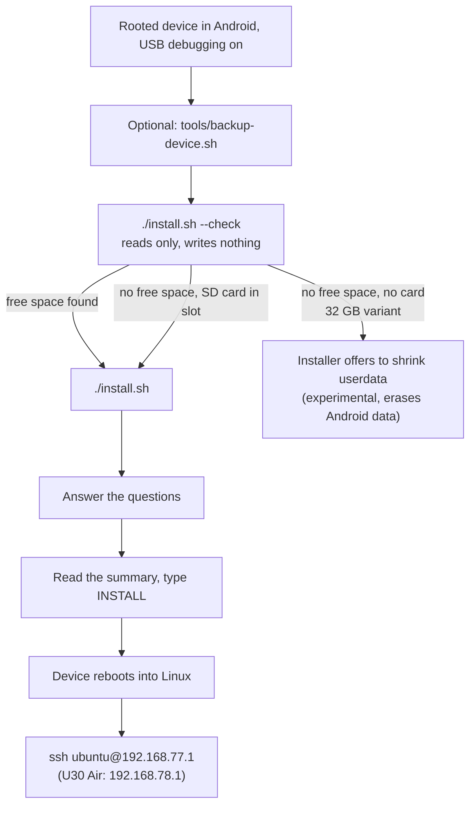
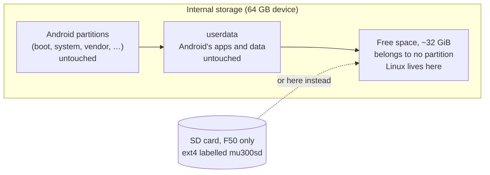

# Installation

**In one sentence:** you plug the rooted device into a computer, run one script that first only *looks*, then run
it again to install, answer a few questions, type `INSTALL`, and the device restarts into Linux.

**The simple version:** the installer is a careful mover. It measures the empty room first (`--check`), tells you
exactly which boxes it will put where, waits for you to say yes, and never moves Android's furniture.

> **Hobby project, no warranty.** Rooting, unlocking and patching are not part of this project and happen at your own risk.
> A wrong step, a power cut or a bad cable can still leave a device unusable. Keep a backup. See the
> [full notice](https://github.com/dikeckaan/mu300-linux#a-hobby-project-at-your-own-risk).



## What you need

* A **ZTE F50 / MU300** or **ZTE U30 Air** that is already **rooted, and able to boot a modified boot image**: an
  unlocked bootloader, or a locked one with a patched TrustOS. Getting there is not part of this project: it does
  not root, unlock or patch devices and gives no guide for it.
  * A **locked bootloader is not refused.** `--check` and the installer print a warning - "The bootloader is
    locked. Did you patch TrustOS?" - and go on. With a patched TrustOS Linux boots on a locked bootloader; without
    it the device goes back to Android by itself after the install.
* **USB debugging** enabled, and the device connected by USB.
* A computer with **`adb`**:
  * **macOS or Linux:** also Python 3, `lz4` and `curl` (usually already there).
  * **Windows 10/11:** PowerShell. The installer installs Python 3 (for your user, with winget or from python.org)
    and its `lz4` module itself when they are missing. Use `install.ps1`, or `install.cmd` from cmd.exe (no
    execution-policy change needed).
* About 15 minutes.

Get the project with `git clone https://github.com/dikeckaan/mu300-linux` or download it as a zip from GitHub. You
do not need to download the images yourself: the installer fetches the newest release and checks its SHA256 sums.

## What gets written (and what never does)

* Linux goes into **empty, unused space** on the internal storage (about 32 GiB on the usual 64 GB device), or onto
  an **SD card** (F50 only).
* The installer writes the boot partition of the slot Android is **not** on (`boot_b`, or `boot_a` when Android runs
  from slot b, as it often does after an OTA update) and **32 bytes of `misc`**.
* On the 64 GB device, **Android, its data and the partition table are never modified.**
* The exception is the 32 GB variant, see below.
* From v2026.10.20 the installer also copies the **boot chain** of Android's slot to the Linux slot where the two
  differ, see [below](#the-boot-chain-of-the-linux-slot).

### The boot chain of the Linux slot

Linux boots with the bootloader chain of its own slot but runs Android's modem. After an Android update (OTA) the two
slots hold different firmware builds, and the Linux slot's chain is still the factory one, which has kept the modem
from starting on updated devices (issue #86). So the installer copies `uboot`, `sml`, `teecfg`, `trustos` and
`vbmeta` of Android's slot to the Linux slot whenever they differ - only those five, never the NV or calibration
partitions or anything of Android's slot. The images the Linux slot held are backed up first (`.mu300/bootchain/` on
the Linux filesystem and `work/bootchain/` on the computer), every written image is read back, and a mismatch puts
the old ones back and stops before Linux is armed. The summary says what it will do ("boot chain: identical on both
slots" on a device that never took an update). Experts skip it with `MU300_SYNC_BOOTCHAIN=0` (`install.ps1
-NoBootchainSync`). From Android, `su -c 'mu300-linux bootchain'` shows the state and `... bootchain sync` copies.
Thanks to kano for the advice.



## Step 0: back up what cannot be replaced (recommended)

```sh
tools/backup-device.sh          # macOS / Linux, device in rooted Android
```

It copies your unit's own data (`prodnv`, the modem calibration and IMEI partitions, the bootloader chain) to your
computer and verifies every dump. Installing never touches these, but if they are ever lost no firmware download can
bring them back. Keep the folder private: it contains your IMEI.

## Step 1: check the device (reads only)

```sh
./install.sh --check          # macOS / Linux
.\install.ps1 -Check          # Windows (PowerShell)
install.cmd -Check            # Windows (cmd)
```

It prints the storage size, where Android's partitions end and how much free space follows. What the result means:

| `--check` says | Meaning |
|---|---|
| about 32 GiB free, `OK: free and empty, same layout as the tested device` | the usual 64 GB device, ready |
| `OK: free and empty, smaller than on the tested device but enough for both systems` | fine |
| `room for one system only` / `OpenWrt fits, Ubuntu does not` | a smaller gap: pick accordingly |
| no free space at all | the **32 GB variant** (see below) |
| `the installer will offer the SD card instead` | no room inside, but a card is in the slot: no repartitioning needed |
| `WARNING: the unpartitioned space is not empty` | something wrote there; installing would overwrite it (you would have to type `overwrite`) |

If the numbers look like none of these, stop and [open an issue](https://github.com/dikeckaan/mu300-linux/issues)
with what `--check` printed.

### The 32 GB variant

On the 32 GB device `userdata` fills the whole disk, so there is no free space. You have two ways:

* **An SD card (F50):** erases nothing on the internal storage. The installer offers it.
* **Shrink `userdata`:** the installer can make room, asks how many GiB to give Linux and keeps at least 4 GiB for
  Android. **This rewrites the partition table and erases everything in Android. It is experimental** and you must
  type `ERASE`. Take a full backup with `tools/backup-device.sh` first.

How it goes (ported from kano's desktop installer, EXPERIMENTAL, not yet run on a device by this project):

1. The installer saves a backup (partition table, `misc`, `boot` and the boot chain of both slots; never the NV or
   calibration partitions) and a record of what it prepares, a *transaction*, on your computer in
   `~/mu300-backups/` - keep that folder.
2. It shrinks `userdata`, writes a token at the start of the new free region and asks Android's own recovery to
   reset Android on the next start. Android's data is encrypted, so only Android itself can format it again.
3. The device restarts into recovery, which erases Android's data (a factory reset), and Android starts as new.
   This takes a few minutes and more than one restart.
4. Set Android up again, turn USB debugging on, and bring root back: install the Magisk app again and let Shell
   have root (Magisk itself is still in the boot partition).
5. Run the installer again. It finds the transaction and checks that this is the same device, slot, partition
   table, region and token, and the same installer; then it installs as usual into the region. If anything differs
   it stops and writes nothing. `--no-resume` ignores the transaction, `--resume` insists on one,
   `--transaction FILE` names one.

### The SD card (F50 only)

With a card of at least 700 MiB in the slot, the installer asks whether Linux goes there or into the internal free
space (`MU300_STORAGE=sd` answers it). The card is formatted as ext4 labelled `mu300sd`; a card that holds another
Linux (ext4) filesystem is never formatted. Insert the card while the device is **off**. A `mu300sd` card always
starts first. Note: the boot image starts *any* card labelled `mu300sd`, so whoever holds the device can start a
system of their own from a card. The U30 Air has no card slot.

## Step 2: install

```sh
./install.sh                  # macOS / Linux
.\install.ps1                 # Windows (PowerShell)
install.cmd                   # Windows (cmd)
```

### Two questions before the device is looked at

* **The language**: English, Türkçe or 中文 (`MU300_LANG=tr` or `.\install.ps1 -Lang zh` skips the question).
* **"Use the graphical installer?"** - see [The graphical installer](#the-graphical-installer) below. Answer no for
  the text installer this page describes; `MU300_GUI=0` never asks.

And one more, only when it applies:

* **"Install the beta ... instead of ...?"** When GitHub has a prerelease that is newer than the newest full
  release, the installer names both and asks. The default is no: a beta has not run on a device as long as a
  release. Nothing is asked when there is no such prerelease, when you named a release yourself
  (`MU300_RELEASE=<tag>`, `.\install.ps1 -Release <tag>`), or when GitHub's list cannot be read (offline, its rate
  limit): then it is the newest release, as before.

First it brings your copy of the project up to date from GitHub and restarts itself if anything changed
(`MU300_NO_SELF_UPDATE=1` / `-NoSelfUpdate` skips that).

### The questions, one by one

| The installer asks | What it means | If unsure |
|---|---|---|
| *Where should the Linux filesystem go: internal storage or the SD card?* (only with a card) | where Linux lives | `internal` on a 64 GB device |
| *What should be installed?* 1) Ubuntu LTS 2) OpenWrt 3) both | the system(s); see [Choosing a System](Choosing-a-System) | 3 (both) is the default |
| *Which OpenWrt?* 1) the standard LuCI web interface 2) with the MU300 control panel | plain OpenWrt, or OpenWrt with the modem panel | see [Control Panel (LuCI)](Control-Panel-(LuCI)) |
| *Which one should boot* | with two systems: which starts first | either; switch later with `mu300-os` |
| *Which Ubuntu?* 1) 24.04 LTS 2) 26.04 LTS | Ubuntu release | 24.04 (the longest tested) |
| *Boot Linux by default instead of Android?* | yes: Linux starts on every power-on, Android after failed boots | yes |
| *Failed boots before Android (1-6)* | how many unfinished starts in a row before it gives up and goes to Android | 5 (default) |
| *Copy Android's hotspot name and password to Linux?* | your Wi-Fi keeps its name and password | yes |
| *Include the Mali GPU (OpenCL) userspace (~90 MiB)?* | GPU compute support | yes |
| *Install the VPN module?* | the optional [VPN](VPN) (about 40 MB to download) | no, add it later if needed |
| *Install the web panel for Ubuntu?* (Ubuntu only) | Cockpit with the MU300 page, from the release's offline file (about 24 MB more; see [Control Panel (LuCI)](Control-Panel-(LuCI)#a-web-panel-on-ubuntu-cockpit)) | no, add it later with `mu300-extra install panel` |
| *adb to Linux is on and lets every computer in ... Let in only this computer's adb key instead?* | adb to Linux over the cable is on by default, with a root shell and no password for anyone who plugs in a cable; `yes` closes it to all but the computer you install from (see [adb to Linux](#adb-to-linux)) | no (every computer; change it later with `mu300-usb adb auth keys` or `mu300-usb adb off`) |
| *Which kernel?* 1) 5.4 2) 6.18 3) 7.2 4) 7.3 | the core of Linux; see [Kernels](Kernels) | 1 (5.4), or 2 (6.18) for Ubuntu 26.04 |
| *update or wipe* (only when Linux is already there) | `update` keeps everything you added to the systems or changed in them (see [Updating](Updating#what-an-update-keeps)); `wipe` erases the Linux filesystem and starts fresh | update |
| *Password for the "ubuntu" user (Ubuntu) and "root" (OpenWrt)* | your login password, at least 6 characters | choose a good one |

**About the failed-boot count:** a boot counts as failed when it never finishes starting up (power goes, the battery
runs out, Linux hangs) before about a minute after power-on. One good boot resets the count. Higher is more
forgiving of flaky cables; lower gets you to Android sooner. It is also your way back to Android without a computer:
cut the power while it is starting that many times in a row.

### The summary, and `INSTALL`

The installer downloads the images, copies the Wi-Fi and modem files **from your own device** (the published images
contain no proprietary files), then shows exactly what it will write, for example:

```
==> Ready to install
  systems:        ubuntu openwrt (Ubuntu 24.04) (boots: ubuntu)
  kernel:         6.18 (mainline, …)
  default boot:   Linux (Android after 5 failed boots in a row)
  filesystem:     CREATE new ext4 (erases the Linux region)
  writes:         Linux region at offset …, boot_b, 32 bytes of misc (boot_a, GPT and userdata are not touched)
Type INSTALL to continue [no]:
```

Type `INSTALL` (in capitals) to go ahead; anything else cancels. It also installs a small Magisk module in Android
so you can start Linux from Android later, then reboots into Linux.

If the device is running Linux rather than Android when you start, the installer notices and offers to reboot it into
Android for you: over adb where the device lets the computer in (the default; no password to type), else over SSH.
A device in Linux is in `adb devices` too, as `MU300LINUX-...`, and is never installed to as it is.

## The graphical installer

The same installation in a window: `install.sh` and `install.ps1` offer it when you start them by hand, and it can be
started directly with `python3 gui/mu300-gui.py` (Windows: `py gui\mu300-gui.py`).


It needs **Python 3.8 or newer with tkinter, Tk 8.6 or newer**. The installer looks for one in every usual place,
not only on `PATH`, and says which part is missing:

| | where it looks | when tkinter is missing |
|---|---|---|
| Windows | `python`, `python3`, `py -3`; `%LOCALAPPDATA%\Programs\Python\Python3*`; `%ProgramFiles%\Python3*`; the Microsoft Store's Python | it asks for the path of a `python.exe`, or installs Python 3.12 with `winget` after showing the command and getting a yes |
| macOS | `python3` on `PATH`, Homebrew (`/opt/homebrew/bin`, `/usr/local/bin`), python.org's builds, `/usr/bin/python3` | `brew install python-tk@3.x` for a Homebrew Python (shown first, run after a yes); or Python from python.org. **macOS's own Python has Tk 8.5, which cannot draw the window on current macOS: it is not used** |
| Linux | `python3` on `PATH`, `/usr/bin`, `/usr/local/bin` | `sudo apt-get install -y python3-tk` (Debian, Ubuntu), `sudo dnf install -y python3-tkinter` (Fedora), `sudo pacman -S --noconfirm tk` (Arch), `sudo zypper install -y python3-tk` (openSUSE) - shown first, run after a yes |

Nothing is installed without a yes, and a no or a failure simply goes on with the text installer.

What the window does:

* **Device**: the adb devices as they come and go, the model, Android's build, whether USB debugging is authorised,
  **root** and the **bootloader** each for itself. Only missing root stops an installation; a locked bootloader is
  shown as a warning with the question whether TrustOS is patched, and again in the summary before the start. This
  project does not root, unlock or patch devices and gives no help with it; the window says so too.
* **Storage**: the internal storage as a bar - Android's partitions, `userdata`, the free space Linux goes into -
  with the figures of `--check`, the SD card, and on a device without free space what making room would do.
* **What to install**: every question of the table above, with the same defaults.
* **Backup**: what is copied to the computer before anything is written (Android's boot image and the first block of
  `misc`), where it goes, and a button that only makes that copy. The NV and calibration partitions are never copied.
* **Install**: the stages, the download with its speed, the SHA256 checks, and the installer's own summary in a
  dialog - only "Install now" there sends `INSTALL`. Stopping is offered while nothing has been written to the
  device, and not after.
* **Finish**: the SSH address and login for your device and system, and what happens if Linux does not start.
* **Manage**: start Linux from Android, uninstall; for a device that runs Linux, its release, kernel and system, an
  update, another kernel, back to Android. **Help**: the links, and a diagnostics report for an issue.

The window is in English, Türkçe and 中文 (switch at the bottom left), light or dark as the system is. Logs it shows,
copies or saves have serial numbers, IMEI, IMSI, ICCID and passwords masked. It installs nothing by itself: it runs
`install.sh` / `install.ps1` with your answers ([how](https://github.com/dikeckaan/mu300-linux/blob/main/docs/INSTALLER-AUTOMATION.md)),
so everything on this page about what is written and what is not holds for it too.

## Step 3: log in

Wait about a minute, then on the computer the device is plugged into:

| | F50 / MU300 | U30 Air |
|---|---|---|
| Ubuntu | `ssh ubuntu@192.168.77.1` | `ssh ubuntu@192.168.78.1` |
| OpenWrt | `ssh root@192.168.77.1` | `ssh root@192.168.78.1` |
| OpenWrt web interface | http://192.168.77.1 | http://192.168.78.1 |

Use the password you chose. The Wi-Fi network the device broadcasts is its hotspot; unless you chose otherwise it has
the name and password copied from Android. A USB serial console is there too: `screen /dev/cu.usbmodem* 115200` on
macOS. Then try `sudo mu300-toolkit`.

**macOS tip:** macOS does not set up a network interface it has never seen while the screen is locked. Unlock the Mac
the first time you plug the device in.

### adb to Linux

Linux offers `adb` over the same cable, next to the USB network and the serial console, as Android does: `adb shell`
(a root shell), `adb push`/`pull`, `adb forward`. From the release after v2026.10.23 it is **on by default and lets
every computer in**, so that the web installer (a browser) or a GUI can talk to the device without a key having been
put on it first.

**What that means:** adb has no password. With the default, **anyone who can plug a USB cable into the device gets
a root shell**, also after you set passwords, and can read and change everything on it. It is on the cable only:
nothing is reachable over Wi-Fi, the LAN or mobile data. If the device is ever out of your hands, close it:

```sh
sudo mu300-usb adb auth keys                        # only computers whose key you authorised get in
sudo mu300-usb adb off                              # no adb at all
```

Both stay across reboots and updates. The rest:

```sh
mu300-usb adb status                                # on or off, whom it lets in
scp ~/.android/adbkey.pub ubuntu@192.168.77.1:      # a computer's key (root@ on OpenWrt; .78.1 on a U30 Air)
sudo mu300-usb adb key ~/adbkey.pub                 # authorise it (/etc/mu300/adb_keys), for "auth keys"
sudo mu300-usb adb keys                             # the authorised keys
sudo mu300-usb adb auth open                        # every computer again
sudo mu300-usb adb on                               # after "off"
```

A device that was set up before keeps what it had: `adb off` stays off, and a device where adb was turned on or a
key was authorised under v2026.10.20-23 stays keys-only until `sudo mu300-usb adb auth open`. Every other device has
adb on and open after an update. The installers ask whether to let in only the computer they run on; the Magisk zip
does not ask, its systems start open.

The device shows up in `adb devices` as `MU300LINUX-...`. In keys mode a computer whose key is not authorised sees
`unauthorized` and gets nothing (no prompt on the device). There is no TCP port in either mode. adb needs a kernel
with FunctionFS: 5.4, or the mainline kernels of v2026.10.20 or newer; it is not there while a U30 Air's port is a
USB host.

## Installing from the browser: the web installer

https://kaandikec.com/mu300-linux/web-installer/ installs, updates and removes Linux from **Chrome or Edge** over
USB, with no adb, Python or script on the computer. **Tested** (2026-10-13, release v2026.10.25): from start to
finish on an F50 (64 GB, Magisk 30.6) from Chrome 155 on macOS - one system and two, a tab closed in the middle,
Linux started and managed, back to Android, uninstalled. **Not tested yet:** Windows (the adb interface needs the
WinUSB driver), a Linux computer (it needs a udev rule), a U30 Air, an SD card as the target, a root manager other
than Magisk, and the device's own download over real mobile data. The installers above cover those.

* It needs a device rooted with **Magisk 26 or newer**, USB debugging on, and a release newer than `v2026.10.23`.
  It shows whether the device is rooted and what its bootloader says about its lock, and changes neither. An F50
  has no screen: its Android lets every computer's adb in without asking, and Magisk must already allow "Shell"
  root, as the installer for computers needs it too (if it does not: the Magisk app through scrcpy, Superuser).
* You choose the system, the kernel and the release; the page names the file and its size and has the **device
  download it itself** from the release on GitHub, over the device's own internet connection (39 to 124 MB of
  mobile data per system; a download that breaks continues). A device without a connection is told apart, and the
  page then takes a file you download (GitHub does not let a page read release files). Either way the device uses
  the file only with the checksum GitHub publishes for it. The page then starts the **zip's own installer** on the
  device with your answers and shows its progress. Closing the tab does not stop it: connect again and the page
  shows where it is.
* It can back up what an installation writes (not the IMEI/calibration partitions: use `tools/backup-device.sh` for
  those), uninstall, and manage a device that runs Linux with adb on (updates, kernel, restart, logs).
* It does not shrink `userdata` on the 32 GB variant.
* If the browser cannot open the device: another program has it - stop a running adb server (`adb kill-server`)
  and close any other browser window or tab that has the page open and connected; on Windows the adb interface
  needs the WinUSB driver; on Linux a udev rule. The page says which, and has the details.
* "Restart into Android" in the page makes Android the default boot (it is `mu300-next-boot android`); "Make Linux
  the default again" in the page's Linux view, or `mu300-next-boot linux`, undoes it.

With the device in Linux, the same page is a manager for its Wi-Fi, mobile data, VPN, SMS and system settings: [Device Manager](Device-Manager).

How it is built and how to test it: [docs/web-installer.md](https://github.com/dikeckaan/mu300-linux/blob/main/docs/web-installer.md).

## Installing from Android with a Magisk zip (no computer)

A release's Magisk zip can be used in two ways: installed as it is in Magisk, on the device (this section), or
unpacked on a computer, where it is the computer's installer with the zip's system and kernel in it
([below](#a-magisk-zip-on-a-computer)).

If the device runs a rooted Android with **Magisk 26 or newer**, Linux can be installed from the device itself. Each
release has one zip per system and kernel, 15 in all (11 up to v2026.10.19.2, before 7.3), e.g. `mu300-magisk-<tag>-ubuntu-24.04-k5.4.zip` or
`mu300-magisk-<tag>-openwrt-luci-k7.2.zip` (OpenWrt with the control panel); the same zip works on the F50 and the
U30 Air and finds the place by itself. There is no Ubuntu 26.04 zip with kernel 5.4.

1. Put the zip on the device and open it in the Magisk app (Modules, Install from storage), or run
   `su -c 'magisk --install-module /sdcard/Download/<zip>'`. Not from recovery.
2. Read the output: it shows the device, where Linux goes, what it writes and **which password works** - the images'
   own: Ubuntu's user `ubuntu` has the password `ubuntu`, OpenWrt's `root` has none until you set one (`passwd`, or
   LuCI's System > Administration); `MU300_PASSWORD` in the settings file sets one of your own. The same note is in
   `/data/adb/mu300-linux-password.txt` (`su -c cat /data/adb/mu300-linux-password.txt`).
3. Reboot. If Linux does not start, the device returns to Android by itself.

Magisk cannot ask questions, so choices go in a settings file, `mu300-install.conf`. Shrinking `userdata` is not
offered from a zip. The keys, where the file may live and the rules for erasing are in the
[README](https://github.com/dikeckaan/mu300-linux#choosing-something-else-mu300-installconf).

### Updating with a zip

**Installing a zip over an installation is an update, and an update loses nothing.** That is what the zip does by
itself when it finds Linux on the device; nothing has to be set. The plan it prints says so before anything is
written (`update: openwrt v2026.10.27 -> vYYYY.MM.DD.N: everything you added to it or changed in it is kept ...`).

* **Kept:** everything you added to the system or changed in it - files in any directory, settings, accounts,
  services you enabled or disabled - exactly as with `mu300-update apply`
  ([what an update keeps](Updating#what-an-update-keeps)). Packages you installed are installed again at the first
  boot. What could not stay in its place is saved under `/etc/mu300/update-kept/` and listed in
  `/etc/mu300/update-report`.
* **Your password stays** the one the device has, without a question (nothing can be typed while Magisk installs
  a zip) and without a check: the output says "kept, not checked". To have it checked, or to set a new one, put a
  `mu300-install.conf` at the top of the zip before you install it (`zip mu300-magisk-<tag>-...zip mu300-install.conf`
  on a computer, or a file manager that opens zips on Android):
  `MU300_KEEP_PASSWORD=yes` with `MU300_CURRENT_PASSWORD=<the current one>` keeps it once it is checked on the
  device (a wrong one stops the install, nothing changed; no `MU300_CURRENT_PASSWORD` line: no password, OpenWrt's
  `root` as it ships); `MU300_KEEP_PASSWORD=no` with `MU300_PASSWORD=<new>` sets a new one. Delete the zip or the
  file afterwards: it holds the password in plain text. An update takes these only from the zip
  ([README](https://github.com/dikeckaan/mu300-linux#the-password-of-an-update-a-mu300-installconf-in-the-zip)).
* **A zip carries one system and one kernel.** It updates the installed system of its kind (an OpenWrt zip updates
  OpenWrt). The other installed systems and the extras (the VPN module) are not touched; a system that is not
  installed yet is installed beside the others.
* **No network is needed:** the zip has everything, also for a device that was installed long ago.
* **No rollback copy:** the previous system is not kept on this path, so no room is needed for a second copy of
  your files. (`mu300-update apply` on the device keeps one.)
* **An older zip is refused** when the installed system of its kind is newer: an older release may not carry
  everything over. `MU300_DOWNGRADE=yes` in `/data/adb/mu300-install.conf` allows it.
* **`MU300_MODE=wipe`** (from `/data/adb/mu300-install.conf` only) is the opposite of an update: the Linux
  filesystem is made anew, and every installed system, every file in them and the extras are erased. Android, its
  data and the way back to Android are never touched by either.

This holds for zips from the first release with a four-field tag (vYYYY.MM.DD.N) on. An older zip keeps only settings (`/etc/mu300`), accounts and home
directories, `/usr/local`, SSH host keys and OpenWrt's UCI configuration.

## A Magisk zip on a computer

The same zip is also an installer for a computer, with no download: unpack the **whole** zip into a folder and start
`start.cmd` (Windows) or `sh start.sh` (macOS, Linux) - `start-gui.cmd` / `sh start-gui.sh` open the graphical
installer's window straight away. It is the project's `install.sh` / `install.ps1` (in the zip's `computer/`
folder), and it installs exactly the system and the kernel of that zip from the zip's own `payload/`, after checking
both files against the zip's `mu300/manifest` and the release's `mu300/SHA256SUMS`; it asks no question about the
system, the kernel or the release, and does not update itself. Everything else is as in [Step 2](#step-2-install):
the device's own files are read, the summary is shown, and nothing is written before `INSTALL`. `START-HERE.md` in the
zip says it in English, Turkish and Chinese, and `uninstall-linux.cmd` / `sh uninstall-linux.sh` start the
uninstaller.

The zip does not contain adb: Google's platform-tools may not be passed on (section 3.4 of the Android SDK licence).
Download them from https://developer.android.com/tools/releases/platform-tools and unpack them into the zip's folder
(`platform-tools/adb` next to `START-HERE.md`), or have adb on the PATH. The computer also needs Python 3.8+ and lz4
(Windows: the installer installs both when missing, which needs the internet once). The VPN module, when you ask for
it, is still a download; the web panel for Ubuntu is not in a zip (add it later with `sudo mu300-extra install
panel`).

## Downloads are slow?

GitHub's release CDN throttles single connections in some regions. The installer already downloads in 8 parallel
chunks; `MU300_FETCH_JOBS` changes that, and `MU300_RELEASE_URL` points it at your own mirror.

## Next

* [Choosing a System](Choosing-a-System) and [Kernels](Kernels), if you have not decided yet
* [Going Back to Android](Going-Back-to-Android)
* [Troubleshooting](Troubleshooting)
* The illustrated guide: https://kaandikec.com/mu300-linux/install/
