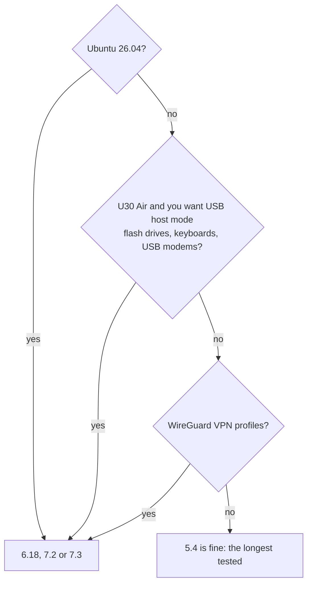

# Kernels

**In one sentence:** the kernel is the engine underneath Linux; you can choose Unisoc's own **5.4** (oldest, longest
tested), mainline **6.18** (long-term support), mainline **7.2** (stable) or mainline **7.3** (newest), and change
your mind later with one command.

**The simple version:** all four engines drive the same car: hotspot, mobile data, SMS, Bluetooth, VPN, GPU. 5.4 is
the one the factory built and the most proven; 6.18, 7.2 and 7.3 are the regular Linux everyone uses, with newer parts.

## The choice, as the installer puts it

| choice | kernel | |
|---|---|---|
| 1 | **5.4** | Unisoc's vendor kernel (Android 12 base): the longest tested, everything this project supports |
| 2 | **6.18** | mainline Linux, the current long-term (LTS) release: newer drivers and security fixes, the same functions (hotspot, mobile data, SMS, Bluetooth, VPN, GPU); no USB-C video output yet |
| 3 | **7.2** | 7.2 (stable): the stable 7.2 series of mainline Linux, newer drivers, the same functions as 6.18; tested less than 6.18 |
| 4 | **7.3** | the newest mainline release: the newest drivers, the same functions as 6.18; tested less than 7.2 |

7.3 comes from the next release after v2026.10.19.2 on; older releases offer the first three.

## Which one should I take?



* **Ubuntu 26.04 needs 6.18, 7.2 or 7.3.** Its programs use system calls 5.4 does not have.
* **The CPU voltage offset (experimental, it can damage the device) is on 6.18, 7.2 and 7.3 only** (on 7.3 not yet
  tried on a device). See
  [CPU Voltage Offset](CPU-Voltage-Offset).
* **USB host mode on the U30 Air** (`mu300-usb host`) needs a mainline kernel (tried on 6.18 and 7.2; not yet on 7.3).
* **WireGuard:** the VPN module notes that the 5.4 vendor kernel has no WireGuard; mainline does.
* **KVM** (`/dev/kvm`) is on all four.
* **The mainline bundles** carry about 360 modules: WireGuard, SQM, tunnels, USB adapters and modems,
  NTFS/exFAT/btrfs/NFS/CIFS, dm-crypt, containers.
* **U30 Air battery:** readings work on every kernel. Charging on the mainline kernels is driven by the `bq256xx`
  driver from v2026.10.12 on; the mainline kernels of v2026.10.11 and older leave charging off, so use 5.4 there.
  From v2026.10.20 the mainline kernels also read the current a Type-C port offers (1.5 or 3 A), so charging on such
  a port runs at up to 2 A instead of 500 mA; the charge limit (0-100 %) works on every kernel.
* **dae** (the VPN module's eBPF engine) needs 6.18, 7.2 or 7.3 of **v2026.10.20 or newer**: those kernels (from
  6.18.56 and 7.2.10 on; 7.3 from the next release on) carry BTF and the BPF JIT. 5.4 cannot run it. kprobes are left out on purpose: with them 7.2 failed 2 boots
  in 36, so `dae trace` is not available.

## The versions in v2026.10.25

| kernel | version | notes |
|---|---|---|
| 5.4 | 5.4.254 | Unisoc's vendor kernel with the project's patches, unchanged since v2026.10.23, which added `NFT_QUEUE` (nftables' `queue` verdict, for userspace packet tools); since v2026.10.21 it no longer panics when a network namespace goes away (#103), and the Wi-Fi driver's routine lines are no longer errors (#140) |
| 6.18 | 6.18.56 | longterm; BTF, BPF JIT, FunctionFS (for adb); rebuilt in v2026.10.25: the U30 Air's charger is also looked for at 0x1a (an SGM41513, #102); v2026.10.23 added the `mu300_thermal` module (the board's temperature as a thermal zone); since v2026.10.22 the F50's SD slot has real card detect (the EIC controller's six banks mapped), so an empty slot is no longer polled and no `mmc1` register dumps fill the log (#181); since v2026.10.21 the Wi-Fi driver can be unloaded (#146) and is quieter (#140) |
| 7.2 | 7.2.10 | stable; the same additions, the same card-detect fix, the same modules |

7.3 is not in v2026.10.25; it comes from the next release after v2026.10.19.2 on, with the same additions and modules.

The point releases bring, among others, a DWC3 USB fix for an IRQ storm that could panic the board, netfilter
flowtable and fq_codel fixes, Bluetooth and USB-serial use-after-free fixes. The BTF data costs about 4 MB of the
boot image and 4 MiB of RAM.

## Known issue: a rare hang on 6.18

About once in 20 boots on one board, 6.18 stopped in its first seconds; the device then falls back to Android (it
can take around 20 minutes, because each hang uses up several tries). Another F50 showed 0 hangs in 100 boots, as did
7.2. Start Linux again with `su -c mu300-linux` in Android or the Magisk module's Action button. Details:
[FINDINGS 31m](https://github.com/dikeckaan/mu300-linux/blob/main/docs/FINDINGS.md#31m-hard-hangs-in-the-first-seconds-under-618-open).

## Changing the kernel later

On the device:

```sh
sudo mu300-update kernel            # shows the current one
sudo mu300-update kernel 6.18       # or 5.4, 7.2, 7.3
sudo reboot
```

The previous kernel and boot image are kept: `sudo mu300-update rollback-boot` goes back. A new kernel that does not
start sends the device back to Android after the usual number of failed boots, even when Linux is locked (see
[Going Back to Android](Going-Back-to-Android)).

## Where the kernels come from

* **5.4** is built from ZTE's published GPL source for the U30 Air (mirrored at
  [dikeckaan/zte-ums9620-kernel-5.4.254](https://github.com/dikeckaan/zte-ums9620-kernel-5.4.254)), with Wi-Fi,
  Bluetooth and GPU drivers from realme's C51/C53 kernel release.
* **6.18, 7.2 and 7.3** are Linux from kernel.org with this project's patches and the vendor drivers ported to them
  ([`upstream/`](https://github.com/dikeckaan/mu300-linux/tree/main/upstream)). A CI job builds the port every week
  against the newest longterm and stable kernels.

The F50 and the U30 Air run the same kernel; the U30 Air's boot image loads a handful of different drivers for its
charger and LEDs.
