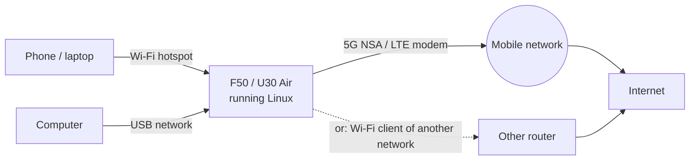

# Mobile Data and APN

**In one sentence:** put a SIM with a data plan in the device and Linux connects to 5G (NSA) or LTE by itself and
shares the connection with everything on its Wi-Fi and USB.

**The simple version:** the modem is a little phone inside the box. Linux dials in for you, keeps watching the line,
and dials again if it drops. Most SIM cards need no settings at all.




## Check it

```sh
sudo mobile-data status
```

No `sudo` on OpenWrt. The connection reconnects by itself after modem resets (`mu300-mobile-data-watch`), unless you
took it down yourself with `mobile-data down`. Other subcommands: `up [APN]`, `down`, `signal`, `sim-reset`.

**No internet?** First check that the SIM has a **data plan**. A missing plan looks like a connection that keeps
dropping.

## The APN

**Leave it empty unless your carrier says otherwise.** Empty means: use the data context the SIM itself defines,
which is what most carriers expect.

| System | Where |
|---|---|
| Ubuntu | `/etc/mu300/mobile-data.conf`: `MU300_APN` and `MU300_PDP_TYPE` (an example is in `/etc/mu300/mobile-data.conf.example`) |
| OpenWrt | LuCI -> Network -> Interfaces -> wan, or `uci set network.wan.apn='…'; uci commit network; ifup wan` |

**An APN with a user name and a password** (a private APN, some MVNOs): set them next to the APN. They need an APN;
printable ASCII, at most 64 characters each, no quotes or backslashes. The authentication is `pap`, `chap`, `both`
(the network picks, and the default) or `none`.

| System | Where |
|---|---|
| Ubuntu | `MU300_APN_USER`, `MU300_APN_PASSWORD`, `MU300_APN_AUTH` in `/etc/mu300/mobile-data.conf` |
| OpenWrt | the same page (APN user name, APN password, APN authentication), or `uci set network.wan.username='…'; uci set network.wan.password='…'; uci set network.wan.auth='chap'; uci commit network; ifup wan` |

The file that holds the password must be readable by root alone; the dial makes it so (`chmod 600`) and does not
start otherwise, and a user name or password without an APN is refused rather than left out. This is new and has
not yet been tried against a network that checks the credentials; if your carrier needs it, a report either way is
welcome.

## Data roaming

**Allowed by default**, as in every earlier release: the device uses mobile data on whatever network the SIM
registers on. Turn data roaming **off** and mobile data stays down while the SIM is registered on a roaming network,
and comes back by itself when it is home again (within about a minute). SMS, calls, USSD and the registration itself
keep working; only the data connection is held back.

```sh
sudo mobile-data roaming        # the setting, the network (home or roaming) and whether data is held back
sudo mobile-data roaming off    # no data while roaming
sudo mobile-data roaming on     # data while roaming too (the default)
```

| Where | How |
|---|---|
| OpenWrt control panel | Status dashboard: the **Data roaming** row (Allowed, Off, or "Off: data held back while roaming") and the **Data roaming** button in Quick controls |
| OpenWrt | LuCI -> Network -> Interfaces -> wan, **Data roaming** next to the APN (one per SIM: `network.wan.roaming` for the external card, `network.wan.roaming_internal` for the internal card / SIM2); or `uci set network.wan.roaming=0; uci commit network` |
| Ubuntu | `MU300_DATA_ROAMING=0` in `/etc/mu300/mobile-data.conf` (one setting for both cards), or Cockpit's MU300 page -> Mobile data |
| Both | `mu300-toolkit` -> Network -> Mobile data: data roaming |

A change applies within half a minute; nothing restarts.

**Some SIMs report roaming at home.** "Roaming" is what the network tells the modem, and an MVNO on another
operator's network, or national roaming, can say so in your own country. If mobile data stops at home after you
turned data roaming off, that is why: turn it back on. The dashboard's Registration row shows what the network says
("Registered (roaming)").

There is no switch for this in the modem that we know of; the dial and its watchdog decide it (details and the
device checklist: [FINDINGS 120](https://github.com/dikeckaan/mu300-linux/blob/main/docs/FINDINGS.md)).

## Data usage

The device counts its mobile data per day and per billing cycle, both ways, the way the operator counts it. The count
survives reboots and switching between systems, and nothing is counted twice. On OpenWrt with the control panel this
is Cellular > Data usage.

```sh
mu300-traffic                       # today, this billing cycle and the cap
sudo mu300-traffic set reset-day 1  # the day a billing cycle starts
sudo mu300-traffic set cap 50G      # a monthly cap; it warns at 90 % unless you set another level
sudo mu300-traffic set cut on       # optional: mobile data off at the cap, back on when the next cycle starts
mu300-traffic days                  # the last days with traffic
```

## Network, band and cell locks (control panel)

On OpenWrt with the control panel, **Cellular -> Network locks** sets network mode, band, cell and EN-DC locks that
persist across reboots and are replayed at boot. The locks are stored in the modem's own memory, so **they also apply
in Android**. "Reset all to automatic" on that page (or `unisoc-modem lock reset` on the command line) clears them.
The **Status dashboard** shows live signal, bands, cells and temperatures. See [Control Panel (LuCI)](Control-Panel-(LuCI)).

## USSD (balance, own number)

```sh
sudo mu300-ussd '*101#'
```

The code depends on your carrier.

## TTL

```sh
sudo mu300-ttl set 64     # a fixed TTL for everything leaving through mobile data
sudo mu300-ttl off        # back to the default
```

Also in `mu300-toolkit` -> Network -> TTL, or the panel's Cellular -> TTL. On the mainline kernels the rule is in tc
and flow offloading stays on; on 5.4 it is in nftables and offloading is off while a TTL is set.

> Changing what your device sends (TTL, band locks, VPNs) may break your operator's terms or local law. Check before
> you turn something on.

## IPv6

Plain OpenWrt uses prefix extension; OpenWrt with the control panel relays IPv6 from the carrier (router
advertisements and NAT66) instead. Since v2026.10.18, when the carrier moves the device to a new /64, the old prefix
is withdrawn, so clients stop using it without a restart of the WAN.

## Wi-Fi beats mobile data

When the device is also joined to another Wi-Fi network as a client, the Wi-Fi route (metric 50) wins over mobile data
(metric 100), so the SIM stays idle. See [Wi-Fi Hotspot and Client](Wi-Fi-Hotspot-and-Client).

## "Websites think I am in another country"

The device has no GPS, so websites guess your location from the IP address, and mobile operators often look like a
different city.

## Saving power (U30 Air)

`mu300-power` can switch the radio to LTE only or off while nobody is connected. See the
[README's power row](https://github.com/dikeckaan/mu300-linux#everyday-use) and
[Hardware Notes](Hardware-Notes#u30-air-battery-buttons-nfc-usb-host).

Deep details (radio registration, the data bearer, modem resets):
[FINDINGS 15, 26](https://github.com/dikeckaan/mu300-linux/blob/main/docs/FINDINGS.md).
