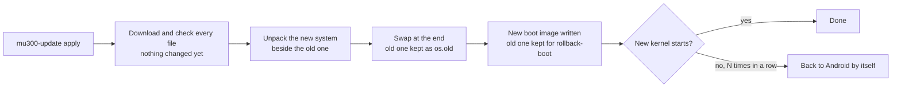

# Updating

**In one sentence:** `sudo mu300-update check` tells you whether there is a new release, `sudo mu300-update apply`
installs it on the device itself, and `rollback` takes you back if you do not like it.

**The simple version:** the device builds the new system next to the old one, moves everything of yours into it, and
only swaps them at the very end. If the download breaks halfway, nothing has changed. The old one stays in the
cupboard until you throw it away.

**What you lose in an update: nothing.** Everything you added to the system or changed in it is kept, whichever way
you update (from the first release with a four-field tag, vYYYY.MM.DD.N, on; see [What an update keeps](#what-an-update-keeps)).

## Commands

```sh
sudo mu300-update check           # installed version vs newest release
sudo mu300-update apply           # system, kernel and boot image: download, unpack, switch; then reboot
sudo mu300-update report          # what the last updates set aside or put back
sudo mu300-update rollback        # back to the previous system
sudo mu300-update rollback-boot   # back to the previous kernel and boot image
sudo mu300-update kernel 7.2      # another kernel: 5.4 (vendor), 6.18 (LTS), 7.2 (stable) or 7.3; no argument shows the current one
sudo mu300-update clean           # delete the kept previous version
```

On OpenWrt you are already root, so leave out `sudo`. `mu300-toolkit` offers the same under
**System -> Software update**. Reboot after `apply` to start the new system and kernel. Only one run at a time: a
second `mu300-update` started while one is going is refused with the first one's pid (from v2026.10.21 on).

The device looks for a new release at boot and every 6 hours and tells you at login, in `mu300-toolkit` and on the
control panel's home page. **It never installs one by itself.**

## From the browser (OpenWrt with the control panel)

**System > Update** in the [control panel](Control-Panel-(LuCI)) does all of the above without a terminal (from the
release after v2026.10.25 on). It runs the same `mu300-update`, so everything on this page applies to it too.

* **Installed** shows the system that runs and its release, the other systems on the device, the kernel, the boot
  image, whether a restart goes to Linux or Android, and the free space. Under it, **Report of the last update**:
  what the last updates carried over, set aside or put back (`/etc/mu300/update-report`, the newest on top; see
  [What an update keeps](#what-an-update-keeps)). It is open while it is new.
* **Online update:** *Check for updates* asks GitHub and shows the newest release, how much the device would
  download and how much free space the update wants (with room for a copy of your files: see
  [Room, and going back](#room-and-going-back)). *Update* starts it. It runs on the device, not in your
  browser: you can close the page, and when you open it again, from any device, it shows how far the update is. At
  the end it offers *Restart now*. A pre-release (a release still being tried) is offered only when you tick it.
* **Update from a file**, for a device without internet: on another computer, download the Magisk zip of the
  release for your system and kernel from the release page (the page tells you its exact name, for example
  `mu300-magisk-v2026.11.02-openwrt-luci-k5.4.zip`) and upload it. Before anything is installed the page shows the
  file's SHA-256, the release, system and kernel it says it is, and whether the project's signature on it is valid.
  A file for another system, kernel or model is refused. A file without a valid signature is installed only after
  you tick that you know nothing proves where it comes from: compare its SHA-256 with `SHA256SUMS-magisk` on the
  release page first. One whose signature is wrong is never installed.
* **Previous version:** *Back to the previous version*, *Back to the previous boot image* and *Remove the previous
  version* are `rollback`, `rollback-boot` and `clean`. Each takes a tick and a confirmation.
* **Kernel:** switch between 5.4, 6.18, 7.2 and 7.3 (`mu300-update kernel`), and *Start Android at the next restart*.

Only one update runs at a time. If one was started in a terminal, the page shows it and waits.

From a terminal the file works too: `mu300-update apply --from FILE.zip --unsigned` (`--unsigned` for a file that
is not signed), or `--from DIR` for a folder with a release's files and their `SHA256SUMS`. `mu300-update inspect
FILE.zip` only looks.

**An older release is never installed by itself**, from GitHub, a mirror or a file: `mu300-update apply` refuses a
release older than what is installed unless you add `--downgrade` (from the release after v2026.10.25 on; before,
`MU300_RELEASE=<older tag>` went back without asking). `rollback` needs no such word: it puts back the copy your
device kept.

### Signed releases

A release can carry a signature of its checksums (`SHA256SUMS.sig`). A system that has the project's release key
(`/opt/mu300/lib/release.pub`) checks it on every update and refuses a release whose signature is wrong, and one
that has none unless you say so (`--unsigned`). Systems up to v2026.10.27 have no key and update as they always did. Details:
[FINDINGS 86](https://github.com/dikeckaan/mu300-linux/blob/main/docs/FINDINGS.md).

### Where the release files come from

GitHub's release CDN throttles single connections in some regions, so the device can take its releases from
somewhere else: a GitHub file proxy (a prefix in front of the release URL), or a copy of a release's files on your
own network. The panel's **System > Update** page has a field for it - *Mirror (release files)*, under **Online
update** - and the command line writes and reads the same file:

```sh
mu300-update source http://mirror.lan/mu300/releases/download
mu300-update source        # what is in force now, and where it comes from
mu300-update source off    # back to GitHub
```

Two addresses are involved, and they are not the same service:

* **the release files** - `MU300_DOWNLOAD_URL` in `/etc/mu300/update-source`; the release tag is added after it, so
  one line keeps working for every release;
* **"which release is newest"** - `MU300_API_URL`, standing for `https://api.github.com/repos/dikeckaan/mu300-linux`.
  The GitHub file proxies in common use serve the first and **not** the second: a request for `api.github.com`
  through one of them comes back `403`. Leave this address alone unless your source serves the API too.

Both live in `/etc/mu300/update-source`, which only root can write (a commented `update-source.example` sits beside
it, and an update keeps the file). The environment wins over the file, which is how the computer installer's
`MU300_RELEASE_URL` and a one-off run work. **The panel's field writes that file** through one `mu300-update source`
command: an account that may use the Update page's write access can change where the device takes releases from, and
the page's read access is what shows the address in force.

**A mirror that cannot be reached is not the end of an update**: it is said once, and that run carries on with
GitHub. The setting stays as you left it, so the next run tries your mirror again. A mirror that *answers* with the
wrong files is another matter - the release is then not installed. A mirror that answers and *stalls* counts as an
answer too: the run keeps taking the files from it rather than moving to GitHub, which is usually the host this
setting exists for.

If the device is on a metered link, that fallback can be the expensive answer - the release would come over mobile
data. So it only happens by itself for an **https mirror on a public name**. A plain-`http://` mirror, or one on a
private address or a LAN-only name (`192.168.x.x`, `10.x.x.x`, `172.16-31.x.x`, `nas.lan`, `box.local`, a name
without a dot), is usually a copy on your own network; when it is off, the update stops and says why instead of
quietly taking the release from GitHub over the SIM. One line in the same file decides it for every mirror:

```
MU300_MIRROR_FALLBACK=0    # never fall back: an update your mirror cannot serve fails
MU300_MIRROR_FALLBACK=1    # always fall back, LAN and http mirrors too
```

## What an update keeps

**Everything you added to the system, and everything you changed in it.** Up to v2026.10.27 an update kept a list
of places (`/etc/mu300`, home directories, `/usr/local`, SSH keys, OpenWrt's `/etc/config`) and the new release
replaced the rest: `/etc/wireguard`, a service you wrote, crontabs, `/var/lib/docker`, `/opt` were gone from the
system afterwards. From the first release with a four-field tag on it works the other way round. Every release image carries a list of its own
files with a checksum of each, so the update knows which files of your system came with the release you are on.
Whatever else is there is yours, and it goes into the new system:

* files in any directory: `/etc/wireguard`, `/etc/netplan`, a systemd unit or an init script you wrote, crontabs,
  `/var/lib/docker`, a database, `/var/www`, `/opt`, `/srv`, `/home`, `/root`, a swap file - with owner, mode,
  times, capabilities and ACLs, hard links and holes as they were;
* settings of the system that you changed (`/etc/ssh/sshd_config`, `/etc/sysctl.conf`, OpenWrt's `/etc/config`);
* accounts and passwords, also the accounts of services you set up;
* services as you enabled or disabled them, and files you deleted stay deleted;
* the vendor files copied from your device (Wi-Fi firmware, the Android modem userspace);
* the installed extras: the lang extra is brought to the new release, the [VPN](VPN) module to its latest release;
* packages you installed yourself (`apk add`, `apt install`): installed again at the first boot (see below), with
  their settings and data carried over like every other file.

It is the same whichever way you update: `mu300-update apply`, the computer installer's **update**, or a
[Magisk zip](Installation#updating-with-a-zip) installed over what is there.

### Where your version and the release's meet

| What | What the update does |
|---|---|
| A file you added | It goes to its place in the new system |
| A settings file of the system that you changed (under `/etc`, `/var`, `/home`, `/root`, `/srv`, `/usr/local`, `/opt`) | **Yours is used.** When the new release changed that file too, its version is saved in `/etc/mu300/update-kept/<old release>/image/`, so you can compare |
| A program file you edited (`/usr`, `/bin`, `/lib`, `/www`), one of the project's own files (`/opt/mu300`, the `mu300-*` services), a package's script under `/etc` (`init.d`, `hotplug.d`) | The release's is used, so that the device works. **Yours is saved** in `/etc/mu300/update-kept/<old release>/user/` |
| A file of the release that you deleted | Stays deleted under `/etc`, `/home`, `/root`, `/srv`, `/usr/local`, `/opt`, and so does a service you disabled. One of the project's own files, or a program file, is back |
| A package of the release that you removed | It is back: it is part of the release's image |
| Packages you installed | Not copied file by file: installed again at the first boot (below). Their settings and their data are carried over at once |
| `/tmp`, `/var/tmp`, `/var/cache`, sockets, what is on another disk (an SD card, a USB stick: the mount point stays), Ubuntu's kernel modules | Not carried: they are made again, or are not part of this system |

**An update never opens what you closed.** adb turned off or limited to keys, your SSH settings and keys, the
firewall, the VPN's kill switch, sudo rules and sysctl settings stay as you set them, with their file modes. A
service you disabled or masked stays off, also one of the project's own; a package you removed comes back with the
release but its service is not started; an account you deleted does not come back with the release's password
(it is locked). Where the release's version of a file had to be used, the report names it.

**Nothing is dropped without a word.** Whatever was set aside or put back is listed in `/etc/mu300/update-report`.
The update prints it, the next login reminds you once, and `sudo mu300-update report` shows it again. What was set
aside stays in `/etc/mu300/update-kept/` through later updates until you delete it
(`sudo rm -r /etc/mu300/update-kept` once you have looked).

### Room, and going back

`apply` keeps the previous system whole as `<os>.old`, exactly as it was when you updated, for `rollback`. Your
files are therefore there twice until `sudo mu300-update clean`. An update writes only what changed: the programs
and libraries of the new release that your system has byte for byte are not written again - the new system and the
kept one share them (one file, two names) - so an update needs room for the download, the new release's changed
files and the copy of what you added, not for a second system. Before it downloads anything `apply` counts that and
says how much is needed and how much is free; the Magisk zip and the computer's installers count it the same way
before they write anything. When the disk has no room, nothing is changed. Then either make room, or update without
keeping the previous system (from a terminal; the panel always keeps it):

```sh
sudo mu300-update apply --no-rollback    # your files are moved over, not copied: needs no room, and there is no rollback
```

Reboot soon after an update. The new system has your files as they were when `apply` ran; what the running system
changes after that stays in the previous one.

While the previous version is kept, replace a program of the system (a package upgrade does), never write into it:
`cp myprog /usr/bin/prog` or a `chmod` of one changes the shared file in both versions. Text files (scripts,
settings) and everything under `/etc`, `/var`, the home directories and `/usr/local` are never shared.

`apply` never goes back to an **older** release by itself: the update is done by the release it installs, and one
from before the first release with a four-field tag would keep only the list of places. `rollback` is the way back. (To install an older
release all the same: `sudo mu300-update apply --downgrade`, the word of [the panel's update](#from-the-browser-openwrt-with-the-control-panel)
too; a Magisk zip asks for `MU300_DOWNGRADE=yes` in `/data/adb/mu300-install.conf`.)

### Coming from a release with a three-field tag

Nothing to do: the new release brings the file lists of every release from v2026.09.21 on. On a system older than
that, or one built by hand, the update cannot tell a file you changed from one the old release shipped. It then
carries over everything the new release does not have, keeps the old list of places as yours, and saves every
other file that differs from the new release's under `/etc/mu300/update-kept/` instead of dropping it. The report
says so.

Should carrying everything over fail on your device, `sudo MU300_UPDATE_KEEP=list mu300-update apply` updates the
way it was done before (the list of places only). Please report it.

## Packages you installed yourself

The release's image has only its own packages. `apply` lists the ones you added before it switches, and the new
system installs them again at its first boot, once it is online (an hour of tries, then again at the next boots, five
at most). Their data (`/var/lib/<name>`) and their settings are in the new system from the start, like every file of
yours. Only their OpenWrt UCI settings (`/etc/config/<name>`) wait in `/etc/mu300/orphaned-config/` until they are back:
settings without their program used to stay active - OpenClash's left the device without DNS. A package the feeds do
not have (installed from a `.apk` file) cannot come back by itself; its settings stay aside. Services come back
enabled or disabled as they were (OpenWrt's init scripts, Ubuntu's systemd units).

On Ubuntu the apt sources you added (`/etc/apt/sources.list.d`, a PPA, with the keys they name, and your pinning in
`/etc/apt/preferences.d`) are kept, so their
packages can come back; the image's own sources are never replaced. A kept source that makes `apt-get update` fail
(a PPA of 24.04 after a move to 26.04) is turned off as `NAME.disabled`, and `status` says so.

In the control panel (OpenWrt with the panel) the same is under **System -> Packages after an update**: what came
back, what did not and why, the settings set aside, and the buttons Try again, Repair DNS (it asks first: DNS then
goes to the carrier) and Dismiss the note.

```sh
mu300-user-packages status    # what came back, what failed and why, how to put settings back
mu300-user-packages retry     # try again now
mu300-user-packages repair-dns  # a proxy that is gone left dnsmasq pointing at it: remove that (never done by itself)
mu300-update apply --no-reinstall   # update without installing them again (MU300_KEEP_PACKAGES=0 does the same)
```

## Why it is safe



* Every file is downloaded and checked before anything changes.
* From v2026.09.28 on, `apply` first switches to the updater of the release it installs.
* The boot image keeps your device's own part and gets the release's kernel and the generic part of its ramdisk, so
  no computer and nothing from Android is needed.
* A kernel that does not start sends the device back to Android after the usual number of failed boots. Even when
  Linux is [locked](Going-Back-to-Android#locked-linux), a new boot image gets its first boots on the usual attempts.

### With the VPN on

A device that uses the VPN is never updated without it. The update brings the module's core and every engine the
device has or a profile needs to their latest release, as one set (engines first, the core last). Offline, it stops
**before** it changes anything and says how to stage the module: put `mu300-linux-vpn-core.tar.gz` with the engine
tarballs (`mu300-linux-vpn-xray.tar.gz`, `-singbox`, `-mihomo`, `-dae`), or the bundle `mu300-linux-vpn.tar.gz` (core,
Xray and sing-box), and their `SHA256SUMS` in `/mnt/mu300-disk/.mu300-update/vpn/`, or run
`MU300_VPN_MODULE=DIR mu300-update apply`. A tarball without a matching `SHA256SUMS` is refused.

### On Ubuntu with the web panel

A new Ubuntu image has no Cockpit in it. The first boot after an update puts the panel extra's packages back in the
background (from the extra when it carries them, else from Ubuntu's archive once the device is online);
`mu300-panel status` says where it is.

## Changing the Ubuntu release

```sh
sudo MU300_UBUNTU=26.04 mu300-update apply   # or 24.04
```

Settings and data are kept. Ubuntu 26.04 needs kernel 6.18, 7.2 or 7.3.

## Release names

A release is named after the day it was built, then a number: **`vYYYY.MM.DD.N`**. `v2026.10.16.1` is the first
release of 16 October 2026 (UTC), `v2026.10.16.2` the second one that day. The releases up to **v2026.10.27** had three
parts (`vYYYY.MM.DD`), and their "day" was only a counter that ran ahead of the calendar: v2026.10.27 came out on
15 October. So:

* every four-part name is newer than every three-part one, whatever the dates say: `v2026.10.16.1` is newer than
  `v2026.10.27`;
* four-part names go by the date, then by the number: `v2026.10.16.10` is newer than `v2026.10.16.9`, and
  `v2026.10.17.1` newer than both.

`mu300-update`, the control panel, the installers and the web installer all compare them this way. A device that
still runs **v2026.10.27 or older** updates to a four-part release as usual with `sudo mu300-update apply` (the new
release's own updater takes over before anything is changed), but its old updater sorts the names as text: until there
is a release dated 27 October 2026 or later, it does not show the "is out" note at login, and `mu300-update check`
there says the device is "newer than the newest release" - run `sudo mu300-update apply` anyway. Details:
[FINDINGS 125](https://github.com/dikeckaan/mu300-linux/blob/main/docs/FINDINGS.md).

## Updating with the computer installer instead

Run `./install.sh` again and answer **update** when it asks *update or wipe*. It reinstalls the systems, writes a fresh
boot image and keeps everything of yours, as `apply` does. It asks whether to keep the current password: yes checks
the one you type against the installed system (three tries, then it stops with nothing changed), no sets a new one,
typed twice. The previous
system is not kept on this path (no `rollback`), so it needs no room for a second copy of your files.

## Updating with a Magisk zip

Install the zip of the new release over the installation, from Android: see
[Installation](Installation#updating-with-a-zip). It keeps everything of yours too, leaves the other installed
systems and the extras alone, keeps your password (a `mu300-install.conf` at the top of the zip can check it or set
a new one), and works without a network.

## Coming from a very old release

**v2026.09.27 or older:** fetch the new updater first, then update, both right after a reboot (older boot images can
lose mobile data after a few quiet minutes):

```sh
sudo curl -fL https://github.com/dikeckaan/mu300-linux/releases/latest/download/mu300-update -o /opt/mu300/bin/mu300-update
sudo mu300-update apply
```

On OpenWrt, as root:

```sh
wget -O /opt/mu300/bin/mu300-update https://github.com/dikeckaan/mu300-linux/releases/latest/download/mu300-update
mu300-update apply
```

**Back in Android after an update?** With older boot images a single crash of Linux could leave the device in
Android. Start Linux with `su -c mu300-linux` (or the Magisk module's Action button), then update as above. If Linux
does not start any more, run the computer installer and choose `update`.

**From v2026.10.14 or older** an update prints "could not arm the Linux slot for a trial", because the older
`mu300-next-boot` does not know `--trial`. The fallback to Android after failed boots still works.

## Backing up your settings

An update keeps your settings, but a new installation, a second device or a broken card do not. `mu300-backup` (Ubuntu
and OpenWrt; on OpenWrt with the control panel also **System > Backup of settings**, and `backup.export` /
`backup.import` of `mu300-api` for the device manager) writes them into one file:

```sh
mu300-backup export --encrypt              # asks for a passphrase twice; ./mu300-backup-HOST-DATE.enc, 0600
mu300-backup export -o /root/settings.json --with-password   # not encrypted, with the login password's hash
mu300-backup show settings.enc             # where it comes from and what it holds (no secret)
mu300-backup import settings.enc --dry-run # what would change
mu300-backup import settings.enc           # change it
```

What it holds: the hotspot (name, password, band, channel, hidden, on/off), mobile data (APN, PDP type,
authentication, user, password, data roaming), the SIM used at boot, the network locks (OpenWrt with the control
panel), the VPN module's own profiles, subscriptions and settings and whether it is on, SMS forwarding (OpenWrt with
the control panel), the LAN address, host name, time zone, SSH on/off, the login user's SSH keys, and with
`--with-password` the hash of the login password.

* **The file holds secrets.** It is written readable by root alone; with a passphrase (`--encrypt`,
  `--passphrase-file FILE`) it is encrypted with AES-256 (openssl, PBKDF2 with 600000 rounds), and a file changed
  afterwards is refused.
* **Every value is checked first**, by the same rules as the setting itself (the hotspot's, the APN's, the lock
  page's, the VPN module's); one refused value and nothing is changed. What is the same is left alone; nothing is
  removed (no VPN profile, subscription or SSH key of the device).
* **A file of another model** (an F50 backup on a U30 Air) is refused unless you add `--force`. A file from the other
  system (Ubuntu to OpenWrt or back) gives what both have; the rest is listed as skipped. OpenWrt cannot read
  Ubuntu's yescrypt password hash: leave the password out there (`--skip password`).
* Subscriptions are fetched again when they are restored, so the device needs internet for them; VPN profiles that
  came from a subscription come back with it.

## Do not

* Do not use OpenWrt's `sysupgrade` or flash OpenWrt firmware images.
* Do not `apk upgrade` the `kernel` or `kmod-*` packages on OpenWrt.
